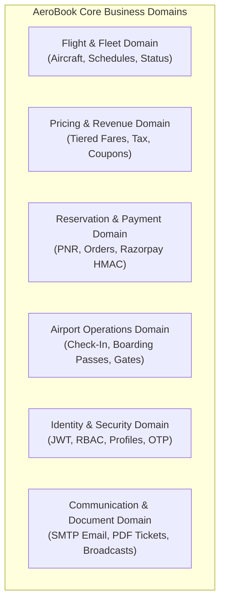

# 01. Project Overview & Business Domain

## 1. Executive Summary

**AeroBook** is an enterprise-grade, cloud-native airline flight reservation, passenger services, airport operations, and fleet management platform. Designed around modern distributed microservices principles, AeroBook provides a seamless, real-time end-to-end journey for airline passengers, airport ground staff, and flight operations administrators.

The application spans **11 Java Spring Boot backend microservices**, **1 Angular 18 Single Page Application (SPA)**, and **8 decoupled MySQL database schemas**, tied together through a reactive **Spring Cloud API Gateway** with client-side load balancing via **Netflix Eureka Service Discovery**.

---

## 2. Business Problem & Objectives

Modern commercial aviation demands robust, highly resilient software architectures capable of handling concurrent flight searches, dynamic fare pricing, high-volume transactional booking reservations, secure cryptographic payment processing, and instantaneous airport ground operations.

### Key Business Challenges Addressed:
1. **Fault Isolation**: Failure in ancillary services (such as notification dispatch or incident reporting) must never prevent a passenger from booking a flight or boarding an aircraft.
2. **Scalability & Decoupling**: High-traffic passenger searches during holiday travel surges require independent horizontal scaling without overloading reservation or payment databases.
3. **Data Integrity & Consistency**: Booking flight seats, processing payments, and issuing passenger name records (PNRs) must maintain strict consistency across distributed services.
4. **Multi-Persona Airport Experience**: Distinct personas (Passengers, Ground Operations Staff, Airline Administrators) require specialized interfaces, strict role-based access control (RBAC), and tailored workflows.
5. **Regulatory Compliance & Standards**: Generating authentic IATA Bar Coded Boarding Passes (BCBP), formal GST/tax invoices, and meeting WCAG AA accessibility standards for digital passenger channels.

---

## 3. Core Domains & Features

### 3.1 Customer / Passenger Domain
- **Flight Discovery**: Real-time origin/destination search, departure date filtering, available seat counter, and flight radar previews.
- **Tiered Cabin Selection**: Transparent pricing across Economy, Business, and First Class cabins with automated tax breakdown (PSF, UDF, CGST, SGST).
- **Promotional Discounts**: Coupon engine supporting percentage discounts with minimum fare criteria and maximum caps (e.g., `AERO2026`, `WELCOME10`).
- **Reservation & PNR**: Instant reservation generation with unique 8-character alphanumeric Passenger Name Record (PNR).
- **Payment Processing**: Integrated Razorpay modal checkout supporting mock simulations, live test tokens, and server-side HMAC-SHA256 signature verification.
- **Digital E-Ticket & Tax Invoice**: High-fidelity dual-view modal, A4-optimized print styles, OpenPDF document download, and email delivery.
- **Web Check-In & Boarding Pass**: Interactive cabin fuselage seat map selection, automated barcode generation (`BP-X-YYZ`), and digital boarding pass retrieval.
- **Passenger Loyalty & Gamification**: Real-time XP tracking, traveler rank tiers (*Bronze Wanderer* to *Diamond Elite*), active streak calculations, and achievement badges.
- **Real-Time Passenger Alerts**: Automated notifications for booking confirmations, gate changes, flight delays, and weather advisories.

### 3.2 Airport Ground Operations (Staff) Domain
- **Passenger Check-In Desk**: Quick passenger search by PNR, seat reassignment, and manual check-in processing.
- **Departure Gate Boarding Scanner**: Real-time barcode validation updating passenger status from `CHECKED_IN` to `BOARDED`.
- **Flight Passenger Manifest**: Real-time visibility into passenger manifests, checked baggage tags, and boarding completion rates.
- **Flight Status Dispatcher**: Operational status updates (`SCHEDULED`, `BOARDING`, `DELAYED`, `DEPARTED`, `CANCELLED`).
- **Airport Incident Reporting**: Ground staff ticketing system for wheelchair assistance, baggage claims, transit advisories, and medical needs.

### 3.3 Airline Administration Domain
- **Commercial Flight Scheduling**: Route setup, departure/arrival timestamps, aircraft linkage, base fare assignment, and capacity limits.
- **Fleet Inventory Management**: Aircraft registration, manufacturer tracking (Airbus, Boeing, ATR), and cabin seating capacity.
- **Revenue & Dynamic Pricing**: Cabin-class multipliers, tax rules, and seasonal pricing adjustments.
- **Coupon & Campaign Management**: Promotional code creation, usage quotas, active/inactive toggling, and date validity.
- **User & Credential Directory**: Cross-platform customer audit, account verification state, and administrative role promotions.
- **System Diagnostics & Monitoring**: Gateway health probes, route registries, and SonarQube code quality dashboards.

---

## 4. User Personas & Access Control

AeroBook strictly enforces three authenticated roles and one unauthenticated public persona:

| Persona | Role Identifier | Access Privileges | Primary Interface |
|---|---|---|---|
| **Guest / Visitor** | *Unauthenticated* | Flight search, schedule browsing, coupon validation, email verification, login/registration | Home Landing Page (`/`) |
| **Passenger** | `ROLE_USER` | Personal flight bookings, payment checkout, web check-in, seat selection, PDF downloads, notifications, loyalty profile | Customer Dashboard (`/customer`) |
| **Ground Staff** | `ROLE_STAFF` | Airport check-in desk, boarding pass scanner, passenger manifest oversight, flight status dispatching, incident logging | Staff Dashboard (`/staff`) |
| **System Admin** | `ROLE_ADMIN` | Flight schedule creation, aircraft fleet management, fare pricing, coupon administration, credential audit, user management | Admin Dashboard (`/admin`) |

---

## 5. Functional & Non-Functional Requirements

### Functional Requirements
- **FR-01 (Authentication)**: Secure registration with BCrypt password hashing, JWT access token generation (24-hour expiration), and refresh token rotation.
- **FR-02 (Role Routing)**: Post-login role inspection automatically routing passengers to `/customer`, ground crew to `/staff`, and administrators to `/admin`.
- **FR-03 (Inventory Synchronization)**: Booking reservations must decrement available seats in real time and reject overbooking.
- **FR-04 (Cryptographic Verification)**: Razorpay payment signatures must be calculated using HMAC-SHA256 and verified prior to marking transactions `CAPTURED`.
- **FR-05 (Automated Document Generation)**: E-Tickets and Boarding Passes must be dynamically generated as vector PDFs using OpenPDF with embedded barcodes.
- **FR-06 (Asynchronous Messaging)**: Confirmed bookings must emit `BOOKING_CREATED` events to RabbitMQ for flight and notification consumers.

### Non-Functional Requirements
- **NFR-01 (Resilience & Decoupling)**: Microservices must maintain isolated data stores (Database-per-Service) and graceful fallback when ancillary services are offline.
- **NFR-02 (Performance & Latency)**: Sub-second response times for flight searches via non-blocking reactive API Gateway routing.
- **NFR-03 (Accessibility - WCAG AA)**: Frontend contrast ratios must exceed 4.5:1 for normal text and 3:1 for graphical elements across both light and dark themes.
- **NFR-04 (Code Quality & Security)**: Zero high-severity vulnerabilities, JaCoCo XML backend test coverage reporting, and SonarQube quality gate integration.
- **NFR-05 (Zero Theme Flicker)**: Immediate pre-paint execution of theme preferences in browser DOM to avoid theme flashing.

---

## 6. Implementation Status & Limitations

### Current Implementation Status
- **Backend Microservices (11/11)**: Fully functional, compiling, tested, and integrated with JaCoCo and SonarQube Maven plugins.
- **Frontend SPA (1/1)**: Fully functional Angular 18 standalone component architecture with 0 mock dependencies, WCAG AA compliance, and automated Karma/ChromeHeadless tests.
- **Database Layer (8/8)**: Schema creation scripts and full master seed data (`scripts/seed.sql`) covering 20 users, 16 aircraft, 25 flights, 25 fares, 16 coupons, 22 bookings, 18 check-ins, 22 payments, and 22 notifications.
- **Quality Analysis**: Complete SonarQube configuration and master automation scripts (`run-sonar-analysis.ps1`, `run-sonar-analysis.bat`).

### Known Operational Limitations
1. **Localhost Routing**: Microservices currently default to `localhost` ports; Kubernetes manifest definitions and cloud container registries are planned for future deployment phases.
2. **RabbitMQ Optional Mode**: RabbitMQ messaging defaults to disabled in development environments lacking a local broker, falling back to direct synchronous REST calls.
3. **Razorpay Live Gateway**: Razorpay operates in test/mock mode using cryptographic simulation tokens unless configured with live merchant API keys in `.env`.

