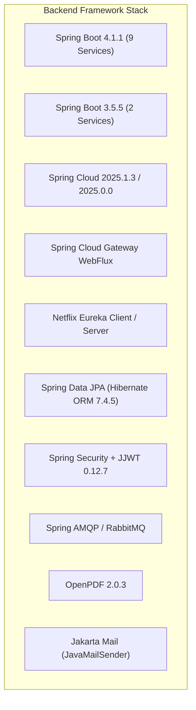
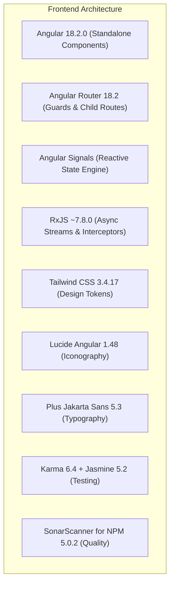

# 02. Complete Technology Stack & Version Matrix

## 1. Technology Inventory Overview

AeroBook is constructed using modern enterprise software engineering tools. Every technology, framework, library, and runtime documented below has been verified directly against source code files, `pom.xml` manifests, `package.json` specifications, and runtime log output.

---

## 2. Core Runtimes & Languages

| Technology | Verified Version | Purpose in AeroBook | Repository Locations |
|---|---|---|---|
| **Java Development Kit (JDK)** | **17 (LTS)** *(Java 20 runtime compatible)* | Primary programming language for all 11 backend microservices | `*/pom.xml` (`<java.version>17</java.version>`) |
| **Node.js** | **v22.17.0** | Runtime environment for Angular build tools, CLI, and test runners | `frontend/package.json` |
| **TypeScript** | **~5.5.2** | Strictly typed frontend language for Angular components, models, and APIs | `frontend/package.json`, `frontend/tsconfig.json` |
| **SQL** | **MySQL 8.x dialect** | Relational data definition and query language for 8 microservice databases | `scripts/seed.sql`, `*/application.properties` |
| **PowerShell** | **5.1 / 7+** | Automation scripting for multi-service orchestration, seeding, and SonarQube | `scripts/*.ps1`, `run-sonar-analysis.ps1` |
| **Windows Shell (CMD)** | **Windows 10/11** | Quick-launch batch runners for developers without PowerShell policy adjustments | `*.bat`, `run-sonar-analysis.bat` |

---

## 3. Backend Microservices Framework & Dependencies

### 3.1 Spring Boot Ecosystem

| Framework / Module | Version | Purpose & Architectural Role | Services Utilizing |
|---|---|---|---|
| **Spring Boot Parent** | **4.1.1** | Core backend microservice framework providing auto-configuration, dependency management, and embedded Tomcat | `service-discovery`, `config-server`, `auth-service`, `user-service`, `fare-service`, `booking-service`, `check-in-service`, `notification-service`, `payment-service` |
| **Spring Boot Parent** | **3.5.5** | Core framework for non-blocking reactive gateway and flight scheduling services | `api-gateway`, `flight-service` |
| **Spring Cloud Dependencies** | **2025.1.3 / 2025.0.0** | Cloud coordination suite managing service discovery, client routing, and configuration import | All 11 microservices |
| **Spring Cloud Gateway WebFlux** | **2025.0.0 (Reactive)** | High-throughput, non-blocking asynchronous reverse proxy, route routing, and JWT filter pipeline | `api-gateway` |
| **Netflix Eureka Server** | **2025.1.3** | High-availability central service registry and heartbeat monitoring | `service-discovery` |
| **Netflix Eureka Client** | **2025.1.3 / 2025.0.0** | Automatic service registration and client-side load balancing (`lb://`) | All 10 client services |
| **Spring Cloud OpenFeign** | **2025.1.3 / 2025.0.0** | Declarative REST client interfaces for synchronous inter-service communication | `auth-service`, `booking-service`, `fare-service`, `flight-service` |
| **Spring Cloud Config Server** | **2025.1.3** | Optional centralized environment configuration repository | `config-server` |

### 3.2 Data Persistence, Messaging & Ancillary Libraries

| Library | Version | Purpose | Component |
|---|---|---|---|
| **Spring Data JPA** | *Spring Boot BOM* | Relational data repository abstraction and CRUD lifecycle management | 8 persistence services |
| **Hibernate ORM** | **7.4.5.Final** | Object-relational mapping (ORM) provider implementing JPA specifications | 8 persistence services |
| **MySQL Connector/J** | **8.x / 9.x** | Official JDBC driver connecting Spring Data JPA to MySQL instances | 8 persistence services |
| **Spring AMQP / RabbitMQ** | *Spring Boot BOM* | Asynchronous message broker abstraction for event publication and consumption | `booking-service`, `flight-service` |
| **JJWT (Java JWT)** | **0.12.7** | Cryptographic HMAC-SHA signing, parsing, and validation of JWT access/refresh tokens | `api-gateway`, `auth-service` |
| **OpenPDF** | **2.0.3** | Airline-grade vector PDF generation for E-Tickets, Tax Invoices, and Boarding Passes | `notification-service` |
| **Spring Boot Starter Mail** | *Spring Boot BOM* | SMTP email dispatch supporting MIME multipart HTML templates | `notification-service` |
| **ModelMapper** | **3.2.1** | Java Bean mapping between JPA Entities and REST DTOs | `flight-service` |
| **Project Lombok** | *Spring Boot BOM* | Compile-time bytecode generation for getters, setters, builders, and constructors | `api-gateway`, `auth-service`, `booking-service`, `flight-service` |
| **Spring Boot Actuator** | *Spring Boot BOM* | Operational production monitoring, metrics, and health probes (`/actuator/health`) | `service-discovery`, `config-server`, `api-gateway`, `booking-service` |

---

## 4. Frontend Single Page Application (SPA) Stack

### 4.1 UI Framework & State Management

| Package | Version | Purpose & Role in AeroBook Frontend |
|---|---|---|
| **@angular/core** | **^18.2.0** | Modern Angular framework utilizing Standalone Components and Signals |
| **@angular/common** | **^18.2.0** | Common pipes (`date`, `currency`, `uppercase`), directives, and formatting |
| **@angular/router** | **^18.2.0** | Client-side routing, route guards (`customerGuard`, `staffGuard`, `adminGuard`) |
| **@angular/forms** | **^18.2.0** | Reactive forms and template-driven form validation |
| **@angular/platform-browser** | **^18.2.0** | DOM rendering engine, browser platform initialization |
| **@angular/animations** | **^18.2.0** | Smooth UI micro-interactions, modal transitions, and accordion animations |
| **rxjs** | **~7.8.0** | Reactive extensions handling HTTP interceptors, polling streams, and event buses |
| **zone.js** | **~0.14.10** | Angular change detection execution context |
| **tslib** | **^2.3.0** | TypeScript runtime helper library |

### 4.2 Styling, Typography & Design System

| Package | Version | Purpose & Role |
|---|---|---|
| **tailwindcss** | **^3.4.17** | Utility-first CSS framework configured with high-contrast dual-theme tokens |
| **postcss** | **^8.5.28** | CSS transformation and Tailwind build pipeline processor |
| **autoprefixer** | **^10.6.1** | Vendor prefixing for cross-browser CSS support |
| **@lucide/angular** / **lucide-angular** | **^1.48.0** | Aviation and dashboard iconography (airplane, calendar, shield, user, etc.) |
| **@fontsource/plus-jakarta-sans** | **^5.3.0** | High-legibility geometric sans-serif corporate typography |

---

## 5. Quality Assurance, Testing & Static Analysis Stack

| Tool / Plugin | Version | Role in Pipeline | Scope |
|---|---|---|---|
| **JUnit Jupiter (JUnit 5)** | **5.10.x** | Unit and integration test runner for backend services | All 11 microservices |
| **Mockito** | **5.x** | Mocking framework for unit testing service layers without live DBs | All 11 microservices |
| **Spring Boot Starter Test** | *BOM* | Integration test harness with MockMvc and Spring context testing | All 11 microservices |
| **Reactor Test** | *BOM* | StepVerifier testing for reactive Gateway WebFlux pipelines | `api-gateway` |
| **JaCoCo Maven Plugin** | **0.8.12** | Java code coverage instrumentation producing XML execution reports | All 11 microservices |
| **SonarQube Scanner for Maven** | **5.0.0.4389** | Maven plugin analyzing Java source code, rulesets, and JaCoCo reports | All 11 microservices |
| **Karma** | **~6.4.0** | Test runner executing Jasmine test specs in real browser environments | `frontend` |
| **Jasmine Core** | **~5.2.0** | Behavior-driven development testing framework for JavaScript/TypeScript | `frontend` |
| **karma-chrome-launcher** | **~3.2.0** | Headless Chrome browser integration for Karma | `frontend` |
| **karma-coverage** | **~2.2.0** | Istanbul/LCOV code coverage reporter for Angular | `frontend` |
| **SonarScanner for NPM (@sonar/scan)** | **5.0.2** | TypeScript and Angular static analysis scanner importing LCOV reports | `frontend` |
| **SonarQube Server (Community)** | **10.5** | Centralized code quality, security vulnerability, and bug analysis server | Root Platform |
| **PostgreSQL** | **15-alpine** | Dedicated relational backend datastore for SonarQube Server | `docker-compose.sonarqube.yml` |

---

## 6. Build Systems, Packaging & Package Managers

| Build Tool | Version | Configuration Files | Purpose |
|---|---|---|---|
| **Apache Maven** | **3.9.16** *(via Maven Wrapper `mvnw`)* | `pom.xml`, `*/pom.xml`, `.mvn/wrapper/maven-wrapper.properties` | Root aggregator compilation, testing, packaging (`jar` / `war`), and SonarQube scan |
| **Angular CLI** | **^18.2.21** | `frontend/angular.json`, `frontend/tsconfig.json` | Single command SPA building, watching, and Karma test launching |
| **npm** | **10.9.2** | `frontend/package.json`, `frontend/package-lock.json` | Dependency resolution, package locking, and frontend script automation |
| **Docker Compose** | **v2.x compatible** | `docker-compose.sonarqube.yml` | Containerized SonarQube + PostgreSQL service orchestration |

