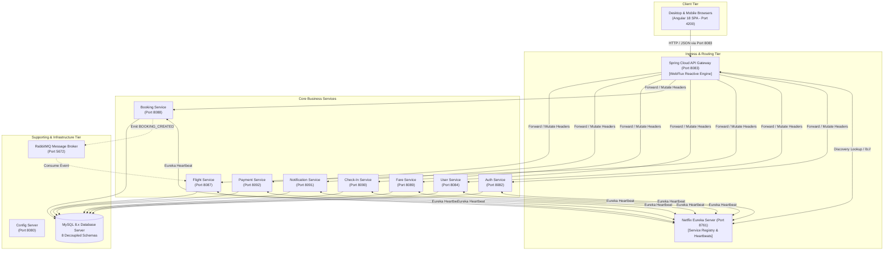
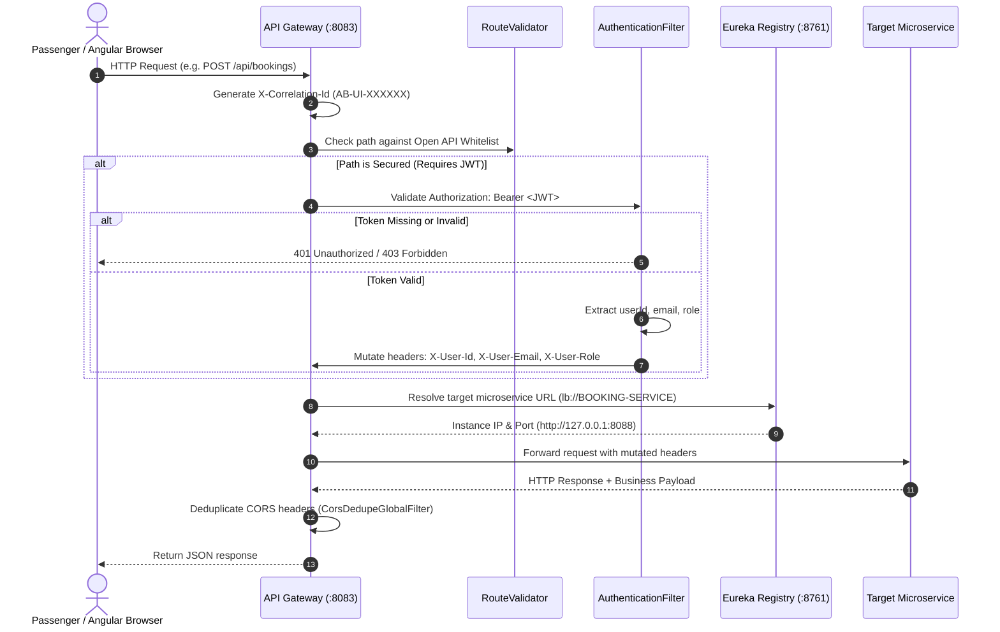
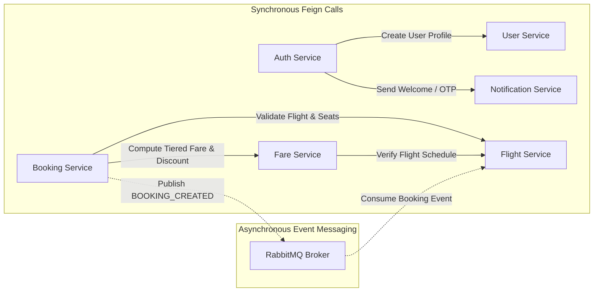

# 03. System Architecture & Design Principles

## 1. Architectural Philosophy & Core Patterns

AeroBook is architectured according to cloud-native microservices patterns to deliver high availability, fault isolation, independent deployability, and maintainability.

### Key Architectural Patterns Implemented:
1. **API Gateway Pattern**: Single unified ingress point (`http://localhost:8083`) shielding internal microservice network topology, terminating CORS, validating JWTs, and tracing requests.
2. **Service Discovery Pattern**: Centralized Netflix Eureka registry (`http://localhost:8761`). Services register dynamically upon boot; the Gateway uses `lb://SERVICE-NAME` for reactive client-side load balancing.
3. **Database-per-Service Pattern**: Each business microservice owns a dedicated, physically isolated MySQL database schema (`aerobook_auth_db`, `aerobook_user_db`, etc.). Direct cross-service database querying is strictly prohibited.
4. **Stateless JWT Security & Token Propagation**: Cryptographically signed HMAC-SHA256 tokens authenticated at the Gateway. User identity is mutated into downstream HTTP headers (`X-User-Id`, `X-User-Email`, `X-User-Role`), liberating backend microservices from duplicate database token lookups.
5. **Hybrid Synchronous & Asynchronous Communication**:
   - **Synchronous (OpenFeign / REST)**: Used where immediate responses are strictly required (e.g. validating seat availability before confirming a reservation).
   - **Asynchronous (RabbitMQ Event Bus)**: Used for decoupled background tasks (e.g. `BOOKING_CREATED` events triggering inventory bookkeeping without blocking passenger responses).

---

## 2. Microservice Boundaries & Responsibilities

| Service Identifier | Logical Name | Port | Database Schema | Core Business Boundary |
|---|---|---|---|---|
| **`service-discovery`** | Eureka Registry | 8761 | *None (In-Memory)* | Central service registry, peer discovery, and liveness monitoring |
| **`config-server`** | Spring Cloud Config | 8080 | *None (Local/Git)* | Centralized configuration repository for distributed service profiles |
| **`api-gateway`** | Cloud Gateway | 8083 | *None (Stateless)* | Reactive ingress reverse proxy, route routing, JWT filter, CORS, correlation tracing |
| **`auth-service`** | Authentication Service | 8082 | `aerobook_auth_db` | Customer registration, BCrypt password hashing, JWT lifecycle, OTP codes |
| **`user-service`** | User Profile Service | 8084 | `aerobook_user_db` | Customer demographic records, user directory, staff incident reporting tickets |
| **`flight-service`** | Flight Schedule Service | 8087 | `aerobook_flight_db` | Commercial flight schedules, route search, operational status dispatch, fleet roster |
| **`fare-service`** | Dynamic Fare Service | 8089 | `aerobook_fare_db` | Tiered cabin pricing, GST tax computation, promotional coupon discounts |
| **`booking-service`** | Reservation Service | 8088 | `aerobook_booking_db` | Flight reservations, PNR generation, passenger manifests, RabbitMQ event dispatch |
| **`check-in-service`** | Airport Check-In Service | 8090 | `aerobook_checkin_db` | Passenger airport check-in, seat assignment, boarding pass generation & gate scanning |
| **`notification-service`** | Alert & Document Service | 8091 | `aerobook_notification_db` | In-app alerts, Gmail SMTP dispatch, OpenPDF airline E-Ticket & Boarding Pass PDFs |
| **`payment-service`** | Razorpay Payment Service | 8092 | `aerobook_payment_db` | Razorpay order creation, HMAC-SHA256 signature verification, webhook processing, refunds |

---

## 3. Ingress Routing & Filter Pipeline

The API Gateway is built on **Spring Cloud Gateway WebFlux**, utilizing non-blocking Netty sockets for high-concurrency throughput.

### Gateway Cross-Cutting Filters:
1. **`CorrelationIdGlobalFilter`**: Generates or propagates an `X-Correlation-Id` across all hops to ensure distributed trace visibility in logs.
2. **`CorsDedupeGlobalFilter`**: Eliminates duplicate `Access-Control-Allow-Origin` headers that can occur when both the Gateway and embedded Tomcat instances attach CORS headers.
3. **`AuthenticationFilter`**: Verifies cryptographic HMAC-SHA256 signatures of JWT tokens, enforces token expiration limits, and injects user identity into downstream headers.

---

## 4. Inter-Service Communication Matrix

### 4.1 Synchronous Invocations (OpenFeign)
- **`Auth Service -> User Service`**: During `/api/auth/register`, `UserClient` invokes `POST /api/v1/users` to synchronize customer demographics into `aerobook_user_db`.
- **`Auth Service -> Notification Service`**: Invokes `POST /api/notifications/email/verify` to dispatch 6-digit OTP codes via SMTP.
- **`Booking Service -> Flight Service`**: `FlightServiceClient` invokes `GET /api/flights/{id}` to verify schedule status and check that `available_seats > 0`.
- **`Booking Service -> Fare Service`**: `FareServiceClient` invokes `GET /api/fares/flight/{flightId}` to calculate exact cabin pricing and apply validated coupons.
- **`Fare Service -> Flight Service`**: `FlightServiceClient` verifies flight schedule existence before permitting administrators to create or update tiered pricing models.

### 4.2 Asynchronous Event Flow (RabbitMQ)
- **Producer**: `BookingEventPublisher` in `booking-service` publishes message payload `BOOKING_CREATED:<pnr>` to direct exchange `booking-exchange` with routing key `booking-created`.
- **Consumer**: `BookingEventConsumer` in `flight-service` listens on queue `booking-created` to asynchronously update internal flight metrics and booking counters.
- **Resilience**: Configured with fallback mechanisms so that if RabbitMQ is unavailable in development, booking operations complete without throwing exceptions.

---

## 5. Architectural Trade-offs & Resilience

| Architecture Decision | Trade-Off Accepted | Mitigating Design Implementation |
|---|---|---|
| **Database per Service** | Cannot execute SQL `JOIN` across booking and flight tables | Implemented OpenFeign clients and consolidated response DTOs |
| **Reactive Gateway Engine** | Netty reactive pipelines require non-blocking code and distinct mental models | Strict separation between reactive Gateway layer and traditional MVC servlet services |
| **Stateless JWT Authentication** | Revoking compromised tokens immediately requires token blacklisting | Short-lived access tokens (24 hours) coupled with refresh token rotation stored in `aerobook_auth_db` |
| **Synchronous Booking Validation** | Booking latency depends on Flight and Fare service response times | Fast in-memory database queries with indexed primary keys; sub-50ms execution times |
| **Zero Mock Frontend** | Local development requires active backend services | Orchestrator scripts (`run-services.ps1`, `start-all.bat`) allow 1-click startup of all 11 services |

