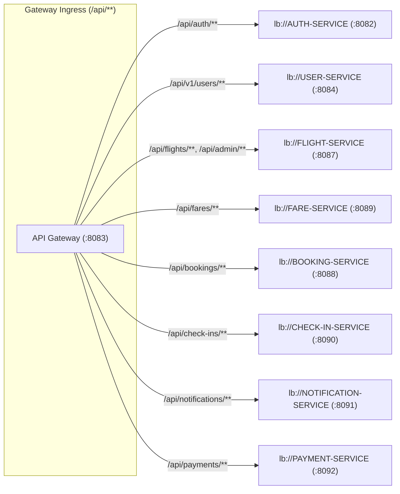

# Microservice: API Gateway (Spring Cloud Gateway WebFlux)

## 1. Executive Summary & Purpose

The **API Gateway** microservice is the intelligent ingress reverse proxy and central traffic controller of the AeroBook platform. Built on **Spring Cloud Gateway 2025** using the non-blocking **Spring WebFlux (Netty)** reactive engine, it provides unified API routing, dynamic client-side load balancing via Eureka, cryptographic JWT authentication, role-based authorization, CORS termination, distributed correlation tracing, and platform diagnostics.

- **Logical Service Name**: `api-gateway`
- **Default Port**: `8083`
- **Health Endpoint**: `http://localhost:8083/api/gateway/health`
- **Routing Engine**: Spring WebFlux Reactive (Netty)
- **Database Schema**: None (Stateless ingress proxy)

---

## 2. Service Boundaries & Key Responsibilities

1. **Unified API Ingress**: Provides a single host and port (`localhost:8083`) for all frontend communication.
2. **Dynamic Service Resolution**: Resolves target microservices via Netflix Eureka using `lb://<SERVICE_ID>`.
3. **Cryptographic JWT Validation**: Intercepts secured routes, verifies HMAC-SHA256 signatures, and checks token expiration.
4. **Downstream Identity Mutation**: Injects validated user identity headers (`X-User-Id`, `X-User-Email`, `X-User-Role`) before forwarding requests to internal services.
5. **Distributed Correlation Tracing**: Injects unique `X-Correlation-Id` tracking identifiers on all incoming requests.
6. **Global CORS Deduplication**: Deduplicates `Access-Control-Allow-Origin` headers between gateway and downstream services.
7. **Platform Architecture Hub**: Exposes `/api/gateway/services` and `/api/gateway/rbac-matrix` diagnostic endpoints.

---

## 3. Technology Stack & Dependencies

- **Language**: Java 17
- **Framework**: Spring Boot 3.5.5
- **Cloud Orchestration**: Spring Cloud 2025.0.0
- **Reactive Engine**: `spring-cloud-starter-gateway-server-webflux` (Project Reactor & Netty)
- **Service Discovery**: `spring-cloud-starter-netflix-eureka-client`
- **Security & Tokens**: `io.jsonwebtoken:jjwt-api:0.12.7`, `jjwt-impl:0.12.7`, `jjwt-jackson:0.12.7`
- **Observability**: `spring-boot-starter-actuator`
- **Testing**: JUnit Jupiter, `io.projectreactor:reactor-test`
- **Quality & Coverage**: `jacoco-maven-plugin:0.8.12`, `sonar-maven-plugin:5.0.0.4389`

---

## 4. Internal Architecture & Source Structure

```text
api-gateway/src/main/java/com/aerobook/apigateway/
├── ApiGatewayApplication.java           # Spring Boot reactive bootstrap
├── config/
│   └── GatewayConfig.java               # Declarative RouteLocator route table & filter chain
├── controller/
│   └── GatewayOverviewController.java   # Diagnostics, services directory, and RBAC matrix
├── dto/
│   └── ErrorResponse.java               # Structured JSON gateway error payload
├── exception/
│   └── GlobalExceptionHandler.java      # Reactive ErrorWebExceptionHandler
├── filter/
│   ├── AuthenticationFilter.java        # Custom GatewayFilterFactory for JWT validation
│   ├── CorrelationIdGlobalFilter.java   # Global filter adding X-Correlation-Id
│   └── CorsDedupeGlobalFilter.java      # Global filter cleaning duplicate CORS headers
├── util/
│   └── JwtUtil.java                     # HMAC-SHA token parser and claims extractor
└── validator/
    └── RouteValidator.java              # Predicate classifying open vs secured routes
```

---

## 5. Route Table & Forwarding Configuration

Configured in [`GatewayConfig.java`](file:///d:/aerobook/api-gateway/src/main/java/com/aerobook/apigateway/config/GatewayConfig.java):



| Route ID | Ingress Path Predicate | Filter Chain | Target Destination |
|---|---|---|---|
| `auth-service` | `/api/auth/**` | `AuthenticationFilter` | `lb://AUTH-SERVICE` |
| `user-service` | `/api/v1/users`, `/api/v1/users/**` | `AuthenticationFilter` | `lb://USER-SERVICE` |
| `flight-service` | `/api/flights/**`, `/api/admin/flights/**`, `/api/admin/aircrafts/**` | `AuthenticationFilter` | `lb://FLIGHT-SERVICE` |
| `fare-service` | `/api/fares`, `/api/fares/**` | `AuthenticationFilter` | `lb://FARE-SERVICE` |
| `booking-service` | `/api/bookings`, `/api/bookings/**` | `AuthenticationFilter` | `lb://BOOKING-SERVICE` |
| `check-in-service` | `/api/check-ins`, `/api/check-ins/**` | `AuthenticationFilter` | `lb://CHECK-IN-SERVICE` |
| `notification-service` | `/api/notifications`, `/api/notifications/**` | `AuthenticationFilter` | `lb://NOTIFICATION-SERVICE` |
| `payment-service` | `/api/payments`, `/api/payments/**` | `AuthenticationFilter` | `lb://PAYMENT-SERVICE` |

---

## 6. Security & Authentication Filter Flow

The [`AuthenticationFilter.java`](file:///d:/aerobook/api-gateway/src/main/java/com/aerobook/apigateway/filter/AuthenticationFilter.java) executes on every route:

1. **Whitelisting Inspection**: Queries [`RouteValidator.java`](file:///d:/aerobook/api-gateway/src/main/java/com/aerobook/apigateway/validator/RouteValidator.java). If path is in `openApiEndpoints` or ends with `/health`, the request passes through unhindered.
2. **Bearer Token Extraction**: Inspects the `Authorization` header. If missing or malformed, returns `HTTP 401 Unauthorized`.
3. **Cryptographic Signature Verification**: Validates the JWT token using `jwt.secret`.
4. **Claims Extraction & Header Mutation**:
   ```java
   ServerHttpRequest mutatedRequest = exchange.getRequest().mutate()
       .header("X-User-Id", String.valueOf(claims.get("userId")))
       .header("X-User-Email", claims.getSubject())
       .header("X-User-Role", String.valueOf(claims.get("role")))
       .build();
   ```
5. **Downstream Execution**: Forwards the enriched request to the downstream target microservice.

---

## 7. Platform Diagnostics Endpoints ([`GatewayOverviewController.java`](file:///d:/aerobook/api-gateway/src/main/java/com/aerobook/apigateway/controller/GatewayOverviewController.java))

| Method | Endpoint | Access | Response Content |
|---|---|---|---|
| `GET` | `/api/gateway/health` | Public | Status (`UP`), port (`8083`), routing engine, Eureka registration state |
| `GET` | `/api/gateway/services` | Public | Metadata, ports, databases, and responsibilities for all services |
| `GET` | `/api/gateway/endpoints` | Public | Exhaustive list of platform endpoints, HTTP methods, and required roles |
| `GET` | `/api/gateway/rbac-matrix` | Public | Detailed Role-Based Access Control matrix across all user personas |
| `GET` | `/api/gateway/presentation-script` | Public | Step-by-step evaluator testing flow for live demonstrations |

---

## 8. Testing & Validation

### Running Unit & StepVerifier Tests:
```powershell
cd d:\aerobook\api-gateway
.\mvnw.cmd test
```
- Tests run: 9 passed (`ApiGatewayApplicationTests`, `GatewayOverviewControllerTest`, `RouteValidatorTest`)
- JaCoCo Report: `target/site/jacoco/jacoco.xml` (77 KB)

### Starting the Gateway:
```powershell
.\mvnw.cmd spring-boot:run
```
Once booted, all incoming frontend API traffic passes through `http://localhost:8083`.

