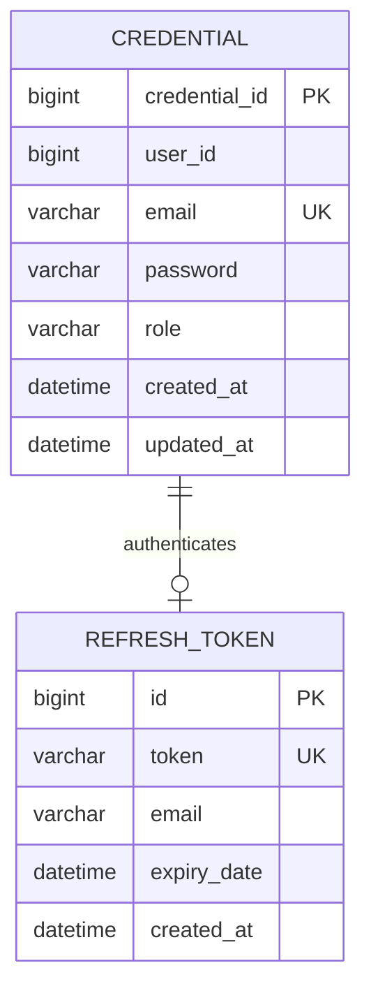

# Microservice: Auth Service (Authentication & Identity)

## 1. Executive Summary & Purpose

The **Auth Service** is the central identity provider and security authority for the AeroBook platform. It manages user credentials, performs one-way cryptographic password hashing (BCrypt), issues cryptographically signed JSON Web Tokens (JWT), manages refresh token lifecycles, coordinates email OTP verification, and enforces Role-Based Access Control (RBAC).

- **Logical Service Name**: `auth-service`
- **Port**: `8082`
- **Database Schema**: `aerobook_auth_db` (MySQL 8.x)
- **Primary Endpoint**: `/api/auth`
- **Health Probe**: `http://localhost:8082/api/auth/health`

---

## 2. Service Boundaries & Responsibilities

1. **Customer Registration**: Validates new user accounts, stores BCrypt-hashed passwords, and synchronizes profile data to `user-service` via OpenFeign.
2. **Privileged Account Provisioning**: Protects administrative (`ROLE_ADMIN`) and ground operations (`ROLE_STAFF`) onboarding via secret setup keys (`X-Admin-Setup-Key`, `X-Staff-Setup-Key`).
3. **Authentication & Token Issuance**: Verifies credentials and generates paired JWT tokens:
   - **Access Token**: Short-lived (24 hours), carrying user claims (`userId`, `email`, `role`).
   - **Refresh Token**: Long-lived (7 days), stored in `aerobook_auth_db` for rotating access tokens.
4. **Email OTP Verification**: Generates and verifies 6-digit one-time passcodes for email confirmation and self-service password resets.
5. **Administrative Access Auditing**: Exposes credential listings and role elevation/demotion endpoints.

---

## 3. Technology Stack & Dependencies

- **Language**: Java 17
- **Framework**: Spring Boot 4.1.1
- **Cloud Orchestration**: Spring Cloud 2025.1.3 (`spring-cloud-starter-netflix-eureka-client`, `spring-cloud-starter-openfeign`)
- **Persistence**: Spring Data JPA / Hibernate 7.4.5, MySQL Connector/J
- **Security & Cryptography**: Spring Security Crypto (`BCryptPasswordEncoder`), `io.jsonwebtoken:jjwt:0.12.7`
- **Build Tool**: Maven 3.9.16 via `mvnw.cmd`
- **Coverage & Static Analysis**: `jacoco-maven-plugin:0.8.12`, `sonar-maven-plugin:5.0.0.4389`

---

## 4. Database Design & Entity Model



### Table: `aerobook_auth_db.credentials`
- `credential_id` (BIGINT, PK, Auto Increment)
- `user_id` (BIGINT, Not Null) - Matches `user_id` in `aerobook_user_db.users`
- `email` (VARCHAR(100), Unique, Not Null)
- `password` (VARCHAR(255), Not Null) - Stored as standard BCrypt hash (`$2a$10$...`)
- `role` (VARCHAR(20), Not Null) - Values: `ROLE_USER`, `ROLE_STAFF`, `ROLE_ADMIN`
- `created_at` / `updated_at` (DATETIME)

---

## 5. Endpoints & API Reference

| Method | Endpoint | Auth Required | Purpose |
|---|---|---|---|
| `GET` | `/api/auth/health` | Public | Operational health status probe |
| `POST` | `/api/auth/register` | Public | Customer account registration (`ROLE_USER`) |
| `POST` | `/api/auth/register-admin` | `X-Admin-Setup-Key` | Privileged admin registration (`ROLE_ADMIN`) |
| `POST` | `/api/auth/register-staff` | `X-Staff-Setup-Key` | Privileged staff registration (`ROLE_STAFF`) |
| `POST` | `/api/auth/login` | Public | Credential authentication returning JWT access & refresh tokens |
| `POST` | `/api/auth/refresh-token` | Public | Refresh token exchange for new access token |
| `POST` | `/api/auth/send-verification-code` | Public | Dispatches 6-digit email confirmation OTP |
| `POST` | `/api/auth/verify-code` | Public | Verifies 6-digit confirmation OTP |
| `POST` | `/api/auth/forgot-password` | Public | Generates password reset OTP code |
| `POST` | `/api/auth/reset-password` | Public | Sets new password upon OTP verification |
| `GET` | `/api/auth/credentials` | `ROLE_ADMIN` | Audits all registered system credentials |
| `PUT` | `/api/auth/credentials/{userId}/role` | `ROLE_ADMIN` | Modifies user authority (`ROLE_USER` <-> `ROLE_ADMIN`) |

### Example Request: `POST /api/auth/login`
```json
{
  "email": "asha.khan@example.com",
  "password": "Password123!"
}
```

### Example Successful Response (HTTP 200 OK):
```json
{
  "accessToken": "eyJhbGciOiJIUzI1NiJ9.eyJzdWIiOiJhc2hhLmtoYW5AZXhhbXBsZS5jb20iLCJ1c2VySWQiOjEsInJvbGUiOiJST0xFX1VTRVIiLCJpYXQiOjE3MjkxNzAwMDAsImV4cCI6MTcyOTI1NjQwMH0...",
  "refreshToken": "48b671e6-0e1a-4d2a-89a6-773a985f1c30",
  "tokenType": "Bearer",
  "expiresIn": 86400000,
  "userId": 1,
  "email": "asha.khan@example.com",
  "role": "ROLE_USER"
}
```

---

## 6. Inter-Service Communication (OpenFeign)

1. **`UserClient` (`user-service`)**:
   ```java
   @FeignClient(name = "USER-SERVICE")
   public interface UserClient {
       @PostMapping("/api/v1/users")
       UserResponse createUserProfile(@RequestBody UserRequest request);
   }
   ```
   Invoked immediately upon customer registration to populate the personal profile in `aerobook_user_db`.

2. **`NotificationClient` (`notification-service`)**:
   ```java
   @FeignClient(name = "NOTIFICATION-SERVICE")
   public interface NotificationClient {
       @PostMapping("/api/notifications/email/verify")
       void sendVerificationEmail(@RequestBody EmailVerificationRequest request);
   }
   ```
   Invoked to dispatch high-priority verification and reset code emails to the user's registered inbox.

---

## 7. Testing & Quality Verification

### Running Test Suite:
```powershell
cd d:\aerobook\auth-service
.\mvnw.cmd test
```
- Tests executed: 17 passed (`AuthServiceApplicationTests`, `AuthServiceImplTest`)
- JaCoCo Report: `target/site/jacoco/jacoco.xml` (119 KB)

