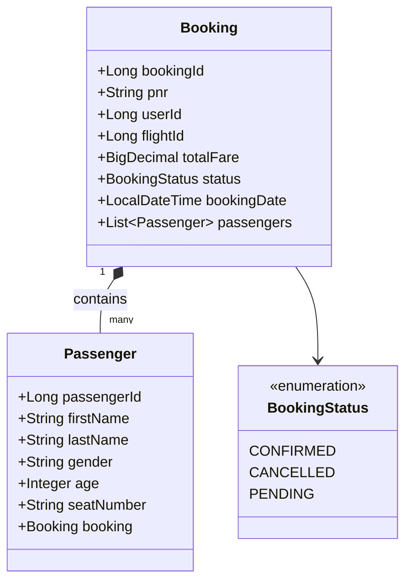
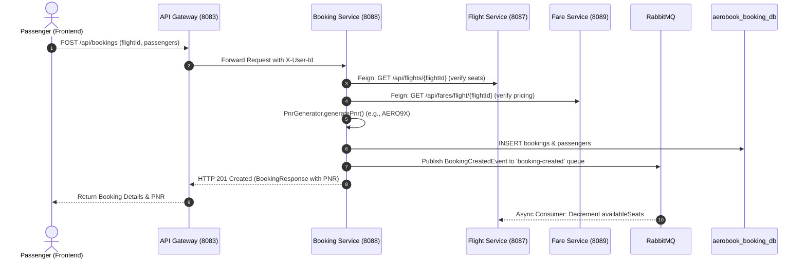

# Booking Service Documentation

## 1. Executive Summary & Responsibility
The **Booking Service** (`booking-service`) orchestrates the flight ticket reservation lifecycle. It acts as the operational core of customer transactions, generating unique 6-character aviation Passenger Name Records (PNRs), validating flight and seat availability via OpenFeign, computing ticket prices with Fare Service, persisting passenger manifest rosters, publishing seat deduction events to RabbitMQ, and managing booking cancellations.

- **Service Name**: `booking-service`
- **Default Port**: `8088`
- **Application Context**: `/`
- **Base URI Path**: `/api/bookings`
- **Spring Boot Version**: `3.3.4` (Java 21)
- **Database Schema**: `aerobook_booking_db` (MySQL)
- **Inter-Service Communication**:
  - OpenFeign: `FlightServiceClient` (`http://FLIGHT-SERVICE`)
  - OpenFeign: `FareServiceClient` (`http://FARE-SERVICE`)
- **Messaging**: RabbitMQ producer publishing `BookingCreatedEvent` to `booking-created` queue
- **Service Discovery**: Registered in Eureka as `BOOKING-SERVICE`

---

## 2. Architecture & Domain Model

---

## 3. Database Schema & Tables

### 3.1 `aerobook_booking_db.bookings`
Stores confirmed and cancelled airline reservations with unique PNR keys.

| Column | Type | Constraints | Description |
|---|---|---|---|
| `booking_id` | `BIGINT` | PRIMARY KEY, AUTO_INCREMENT | Reservation entity ID |
| `pnr` | `VARCHAR(20)` | NOT NULL, UNIQUE | 6-character aviation Passenger Name Record |
| `user_id` | `BIGINT` | NOT NULL | ID of passenger user who placed booking |
| `flight_id` | `BIGINT` | NOT NULL | Commercial flight ID |
| `total_fare` | `DECIMAL(10,2)` | NOT NULL | Final charged ticket total |
| `status` | `VARCHAR(20)` | NOT NULL, DEFAULT `'CONFIRMED'` | `CONFIRMED`, `CANCELLED`, `PENDING` |
| `booking_date`| `DATETIME` | NOT NULL | Reservation creation timestamp |

### 3.2 `aerobook_booking_db.passengers`
Stores individual passenger demographics and seat assignments linked to the reservation.

| Column | Type | Constraints | Description |
|---|---|---|---|
| `passenger_id`| `BIGINT` | PRIMARY KEY, AUTO_INCREMENT | Passenger roster ID |
| `booking_id` | `BIGINT` | NOT NULL, FOREIGN KEY (`bookings.booking_id`) | Parent reservation ID |
| `first_name` | `VARCHAR(50)` | NOT NULL | Passenger legal first name |
| `last_name` | `VARCHAR(50)` | NOT NULL | Passenger legal surname |
| `gender` | `VARCHAR(10)` | NOT NULL | Passenger gender |
| `age` | `INT` | NOT NULL | Age at travel time |
| `seat_number` | `VARCHAR(10)` | NULL | Assigned cabin seat (e.g. `12A`, `14B`) |

---

## 4. REST API Endpoint Catalog

| Method | Path | Request Body / Params | Response Body | Description | Access |
|---|---|---|---|---|---|
| `GET` | `/api/bookings/health` | _None_ | `String` | Health check probe | Public |
| `POST` | `/api/bookings` | `BookingRequest` | `BookingResponse` (HTTP 201) | Create new flight reservation and passengers | Authenticated |
| `GET` | `/api/bookings` | _None_ | `List<BookingResponse>` | Retrieve all bookings across platform | Admin / Staff |
| `GET` | `/api/bookings/{bookingId}` | Path: `bookingId` | `BookingResponse` | Get booking details by ID | Owner / Admin / Staff |
| `GET` | `/api/bookings/pnr/{pnr}` | Path: `pnr` | `BookingResponse` | Retrieve reservation details by 6-char PNR | Authenticated / Staff |
| `GET` | `/api/bookings/user/{userId}` | Path: `userId` | `List<BookingResponse>` | Get all reservations placed by a user | Owner / Admin |
| `GET` | `/api/bookings/flight/{flightId}` | Path: `flightId` | `List<BookingResponse>` | Get all bookings on a specific flight | Admin / Staff |
| `DELETE`| `/api/bookings/{bookingId}` | Path: `bookingId` | `Void` (HTTP 204) | Cancel reservation | Owner / Admin |

---

## 5. Booking Creation & PNR Generation Workflow

