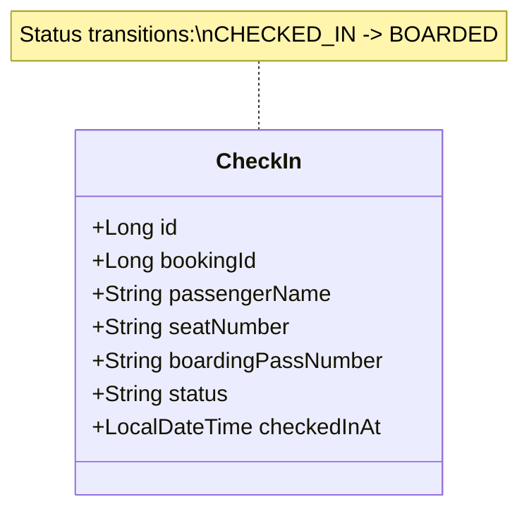

# Check-In Service Documentation

## 1. Executive Summary & Responsibility
The **Check-In Service** (`check-in-service`) manages passenger flight check-in, seat confirmation, boarding pass generation, departure gate boarding verification, and airport operations auditing. It bridges the transition from a confirmed reservation (`booking-service`) to physical aircraft boarding, generating verifiable boarding pass identifiers (format `BP-<bookingId>-<seatNumber>`) and updating passenger statuses during departure gate boarding scans.

- **Service Name**: `check-in-service`
- **Default Port**: `8090`
- **Application Context**: `/`
- **Base URI Path**: `/api/check-ins`
- **Spring Boot Version**: `3.3.4` (Java 21)
- **Database Schema**: `aerobook_checkin_db` (MySQL)
- **Role Enforcement**: Consumes `X-User-Role` forwarded by `api-gateway`
- **Service Discovery**: Registered in Eureka as `CHECK-IN-SERVICE`

---

## 2. Architecture & Domain Model

---

## 3. Database Schema & Tables

### 3.1 `aerobook_checkin_db.check_in`
Stores passenger check-in verification records and boarding credentials.

| Column | Type | Constraints | Description |
|---|---|---|---|
| `id` | `BIGINT` | PRIMARY KEY, AUTO_INCREMENT | Check-in verification record ID |
| `booking_id` | `BIGINT` | NOT NULL | Associated reservation ID in `booking-service` |
| `passenger_name`| `VARCHAR(100)` | NOT NULL | Passenger full legal name |
| `seat_number` | `VARCHAR(10)` | NOT NULL | Confirmed cabin seat (e.g. `12A`, `15C`) |
| `boarding_pass_number`| `VARCHAR(50)` | NOT NULL, UNIQUE | Aviation barcode pass (e.g. `BP-1-12A`) |
| `status` | `VARCHAR(20)` | NOT NULL, DEFAULT `'CHECKED_IN'` | Lifecycle state: `CHECKED_IN`, `BOARDED` |
| `checked_in_at`| `DATETIME` | NOT NULL | Timestamp of digital check-in |

---

## 4. REST API Endpoint Catalog

| Method | Path | Request Body / Params | Response Body | Description | Access |
|---|---|---|---|---|---|
| `GET` | `/api/check-ins/health` | _None_ | `Map<String, Object>` | Health check & operational metrics probe | Public |
| `POST` | `/api/check-ins` | `CheckInRequest` (`bookingId`, `passengerName`, `seatNumber`) | `CheckIn` entity (HTTP 200) | Perform passenger check-in & issue boarding pass | Authenticated |
| `GET` | `/api/check-ins/booking/{bookingId}` | Path: `bookingId` | `CheckIn` entity | Retrieve check-in record for booking ID | Authenticated |
| `GET` | `/api/check-ins/{id}` | Path: `id` | `CheckIn` entity | Retrieve check-in record by primary ID | Authenticated |
| `GET` | `/api/check-ins` | Header: `X-User-Role` | `List<CheckIn>` | List all check-ins (manifest directory) | Admin / Staff |
| `POST` | `/api/check-ins/verify` | Param: `boardingPassNumber` Header: `X-User-Role` | `CheckIn` entity | Airport gate boarding verification (`BOARDED`) | Staff / Admin |

---

## 5. Boarding Pass Lifecycle & Airport Gate Verification
1. **Self-Service Check-In**:
   - Passenger submits `POST /api/check-ins` with `bookingId`, `passengerName`, and chosen `seatNumber`.
   - The service verifies booking eligibility, saves the record with status `CHECKED_IN`, and generates `boardingPassNumber` = `BP-{bookingId}-{seatNumber}`.
   - Triggers downstream notification with generated PDF boarding pass via `notification-service`.
2. **Airport Departure Gate Scan**:
   - At boarding, airline staff scans the physical or mobile boarding pass barcode.
   - Staff frontend calls `POST /api/check-ins/verify?boardingPassNumber=BP-1-12A`.
   - Service verifies existence, transitions status to `BOARDED`, and logs gate clearance.

