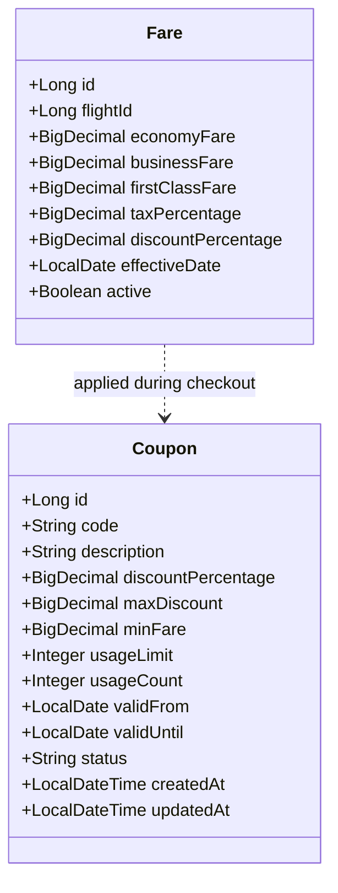

# Fare Service Documentation

## 1. Executive Summary & Responsibility
The **Fare Service** (`fare-service`) is the dynamic pricing and promotional coupon engine of the AeroBook platform. It manages cabin class pricing tiers (Economy, Business, and First Class), dynamic discount calculations, tax percentages (standard Indian aviation GST), and promo coupon lifecycle management with validation constraints.

- **Service Name**: `fare-service`
- **Default Port**: `8089`
- **Application Context**: `/`
- **Base URI Paths**:
  - Flight Fares: `/api/fares`
  - Promotional Coupons: `/api/fares/coupons`
- **Spring Boot Version**: `3.3.4` (Java 21)
- **Database Schema**: `aerobook_fare_db` (MySQL)
- **Inter-Service Communication**: OpenFeign client (`FlightServiceClient`) to validate flight existence
- **Service Discovery**: Registered in Eureka as `FARE-SERVICE`

---

## 2. Architecture & Domain Model

---

## 3. Database Schema & Tables

### 3.1 `aerobook_fare_db.fares`
Stores cabin pricing tiers and tax structures linked to flight schedules.

| Column | Type | Constraints | Description |
|---|---|---|---|
| `id` | `BIGINT` | PRIMARY KEY, AUTO_INCREMENT | Fare record ID |
| `flight_id` | `BIGINT` | NOT NULL, UNIQUE | Associated Flight ID in `flight-service` |
| `economy_fare` | `DECIMAL(10,2)` | NOT NULL | Base Economy cabin ticket price |
| `business_fare` | `DECIMAL(10,2)` | NOT NULL | Base Business cabin ticket price |
| `first_class_fare`| `DECIMAL(10,2)` | NOT NULL | Base First Class cabin ticket price |
| `tax_percentage` | `DECIMAL(5,2)` | NOT NULL, DEFAULT `18.00` | Mandatory aviation tax / GST |
| `discount_percentage`| `DECIMAL(5,2)`| DEFAULT `0.00` | Base promotional discount |
| `effective_date` | `DATE` | NOT NULL | Fare schedule activation date |
| `active` | `TINYINT(1)` | NOT NULL, DEFAULT `1` | Active flag (`1` = True, `0` = False) |

### 3.2 `aerobook_fare_db.coupons`
Stores promotional discount codes and redemption limits.

| Column | Type | Constraints | Description |
|---|---|---|---|
| `id` | `BIGINT` | PRIMARY KEY, AUTO_INCREMENT | Coupon entity ID |
| `code` | `VARCHAR(50)` | NOT NULL, UNIQUE | Promotional code (e.g. `FLY500`, `AERO10`) |
| `description` | `VARCHAR(255)` | NOT NULL | Public promo description |
| `discount_percentage`| `DECIMAL(5,2)`| NOT NULL | Percentage markdown |
| `max_discount` | `DECIMAL(10,2)`| NOT NULL | Maximum discount cap in INR |
| `min_fare` | `DECIMAL(10,2)`| DEFAULT `0.00` | Minimum order fare required |
| `usage_limit` | `INT` | DEFAULT `1000` | Total redemptions allowed across platform |
| `usage_count` | `INT` | DEFAULT `0` | Running counter of redeemed coupons |
| `valid_from` | `DATE` | NULL | Promo start date |
| `valid_until` | `DATE` | NULL | Promo expiry date |
| `status` | `VARCHAR(20)` | NOT NULL, DEFAULT `'ACTIVE'` | Status (`ACTIVE`, `INACTIVE`, `EXPIRED`) |
| `created_at` | `DATETIME` | NULL | Creation timestamp |
| `updated_at` | `DATETIME` | NULL | Last modification timestamp |

---

## 4. REST API Endpoint Catalog

### 4.1 Fare Pricing API (`FareController`)

| Method | Path | Request Body / Params | Response Body | Description | Access |
|---|---|---|---|---|---|
| `GET` | `/api/fares/health` | _None_ | `String` | Health check probe | Public |
| `POST` | `/api/fares` | `FareRequest` | `FareResponse` (HTTP 201) | Create cabin pricing for a flight | Admin |
| `GET` | `/api/fares/{id}` | Path: `id` | `FareResponse` | Get fare record by ID | Public / Services |
| `GET` | `/api/fares/flight/{flightId}` | Path: `flightId` | `FareResponse` | Get active fare structure for flight | Public / Services |
| `GET` | `/api/fares` | _None_ | `List<FareResponse>` | List all flight fares | Public / Admin |
| `PUT` | `/api/fares/{id}` | `FareRequest` | `FareResponse` | Update cabin prices and taxes | Admin |
| `DELETE`| `/api/fares/{id}` | Path: `id` | `Void` (HTTP 204) | Delete fare record | Admin |

### 4.2 Coupon Management API (`CouponController`)

| Method | Path | Request Body / Params | Response Body | Description | Access |
|---|---|---|---|---|---|
| `GET` | `/api/fares/coupons` | _None_ | `List<CouponResponse>` | List all available coupons | Public / Admin |
| `GET` | `/api/fares/coupons/{id}` | Path: `id` | `CouponResponse` | Get coupon by ID | Public / Admin |
| `POST` | `/api/fares/coupons` | `CouponRequest` | `CouponResponse` (HTTP 201) | Create new promotional coupon | Admin |
| `PUT` | `/api/fares/coupons/{id}` | `CouponRequest` | `CouponResponse` | Update coupon terms | Admin |
| `PUT` | `/api/fares/coupons/{id}/toggle` | Path: `id` | `CouponResponse` | Toggle coupon status (ACTIVE/INACTIVE) | Admin |
| `DELETE`| `/api/fares/coupons/{id}` | Path: `id` | `Void` (HTTP 204) | Delete promotional coupon | Admin |
| `POST` | `/api/fares/coupons/validate` | `CouponValidateRequest` | `CouponValidateResponse` | Validate coupon eligibility & calculate discount | Authenticated |

---

## 5. Coupon Validation Logic
When a passenger enters a coupon code during checkout, `POST /api/fares/coupons/validate` executes the following validation pipeline:
1. Lookup coupon by uppercase code.
2. Verify status is `ACTIVE`.
3. Verify current date is within `[validFrom, validUntil]`.
4. Verify `usageCount < usageLimit`.
5. Verify order subtotal >= `minFare`.
6. Compute discount: `min(subtotal * (discountPercentage / 100), maxDiscount)`.
7. Return calculated discount and new payable total.

