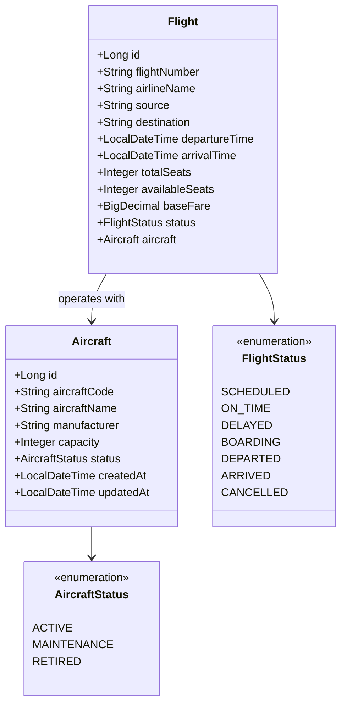

# Flight Service Documentation

## 1. Executive Summary & Responsibility
The **Flight Service** (`flight-service`) manages airline flight schedules, aircraft inventory, seat capacity, real-time flight search, and flight lifecycle states. It serves as the authoritative source of truth for commercial airline routes, aircraft allocation, departure/arrival schedules, and available seat counts.

- **Service Name**: `flight-service`
- **Default Port**: `8087`
- **Application Context**: `/`
- **Base URI Paths**:
  - Public / Passenger Search: `/api/flights`
  - Admin Flight Operations: `/api/admin/flights`
  - Admin Aircraft Fleet: `/api/admin/aircrafts`
- **Spring Boot Version**: `3.3.4` (Java 21)
- **Database Schema**: `aerobook_flight_db` (MySQL)
- **Messaging**: RabbitMQ producer for `flight.queue`, consumer for `booking-created`
- **Service Discovery**: Registered in Eureka as `FLIGHT-SERVICE`

---

## 2. Architecture & Domain Model

---

## 3. Database Schema & Tables

### 3.1 `aerobook_flight_db.aircrafts`
Stores airline fleet records and seat capacity configurations.

| Column | Type | Constraints | Description |
|---|---|---|---|
| `id` | `BIGINT` | PRIMARY KEY, AUTO_INCREMENT | Aircraft fleet entity ID |
| `aircraft_code` | `VARCHAR(50)` | NOT NULL, UNIQUE | Registration code (e.g. `VT-EXA`, `A320-NEO`) |
| `aircraft_name` | `VARCHAR(100)` | NOT NULL | Commercial model name (e.g. `Airbus A320neo`) |
| `manufacturer` | `VARCHAR(100)` | NOT NULL | Manufacturer (e.g. `Airbus`, `Boeing`) |
| `capacity` | `INT` | NOT NULL | Total passenger seating capacity (e.g. 180) |
| `status` | `VARCHAR(30)` | NOT NULL, DEFAULT `'ACTIVE'` | Fleet status (`ACTIVE`, `MAINTENANCE`, `RETIRED`) |
| `created_at` | `DATETIME` | NOT NULL | Aircraft induction timestamp |
| `updated_at` | `DATETIME` | NULL | Last modification timestamp |

### 3.2 `aerobook_flight_db.flights`
Stores scheduled commercial flights, origin/destination city pairs, and real-time seat availability.

| Column | Type | Constraints | Description |
|---|---|---|---|
| `id` | `BIGINT` | PRIMARY KEY, AUTO_INCREMENT | Flight schedule entity ID |
| `flight_number` | `VARCHAR(50)` | NOT NULL, UNIQUE | Commercial flight code (e.g. `AI-101`, `6E-204`) |
| `airline_name` | `VARCHAR(100)` | NOT NULL | Carrier name (e.g. `Air India`, `IndiGo`) |
| `source` | `VARCHAR(100)` | NOT NULL | Origin city / IATA code (e.g. `Delhi`, `DEL`) |
| `destination` | `VARCHAR(100)` | NOT NULL | Destination city / IATA code (e.g. `Mumbai`, `BOM`) |
| `departure_time`| `DATETIME` | NOT NULL | Scheduled local departure time |
| `arrival_time` | `DATETIME` | NOT NULL | Scheduled local arrival time |
| `total_seats` | `INT` | NOT NULL | Total passenger seats allocated |
| `available_seats`| `INT` | NOT NULL | Real-time remaining unreserved seats |
| `base_fare` | `DECIMAL(10,2)`| NOT NULL | Starting base price for economy ticket |
| `aircraft_id` | `BIGINT` | FOREIGN KEY (`aircrafts.id`) | Assigned aircraft from fleet |
| `status` | `VARCHAR(30)` | NOT NULL, DEFAULT `'SCHEDULED'` | Flight operational status |

---

## 4. REST API Endpoint Catalog

### 4.1 Passenger & Public Search API (`FlightSearchController`)

| Method | Path | Request Parameters | Response Body | Description | Access |
|---|---|---|---|---|---|
| `GET` | `/api/flights/health` | _None_ | `String` | Health probe | Public |
| `GET` | `/api/flights/search` | `source`, `destination`, `date` | `List<FlightSearchResponse>` | Search flights matching route and departure date | Public |
| `GET` | `/api/flights` | _None_ | `List<FlightResponse>` | Retrieve all scheduled flights | Public |
| `GET` | `/api/flights/{id}` | Path: `id` | `FlightResponse` | Get single flight details and seat inventory | Public |

### 4.2 Fleet Management API (`AircraftController`)

| Method | Path | Request Body | Response Body | Description | Access |
|---|---|---|---|---|---|
| `POST` | `/api/admin/aircrafts` | `CreateAircraftRequest` | `AircraftResponse` (HTTP 201) | Register a new aircraft to the fleet | Admin |
| `GET` | `/api/admin/aircrafts` | _None_ | `List<AircraftResponse>` | List all aircraft in the airline fleet | Admin / Staff |
| `GET` | `/api/admin/aircrafts/{id}` | Path: `id` | `AircraftResponse` | Get aircraft details by fleet ID | Admin / Staff |
| `DELETE`| `/api/admin/aircrafts/{id}`| Path: `id` | `Void` (HTTP 204) | Delete or decommission an aircraft | Admin |

### 4.3 Flight Operations Management API (`AdminFlightController`)

| Method | Path | Request Body | Response Body | Description | Access |
|---|---|---|---|---|---|
| `POST` | `/api/admin/flights` | `CreateFlightRequest` | `FlightResponse` (HTTP 201) | Create and schedule a new flight | Admin |
| `PUT` | `/api/admin/flights/{id}` | `UpdateFlightRequest` | `FlightResponse` | Update schedule, status, or fare | Admin |
| `GET` | `/api/admin/flights` | _None_ | `List<FlightResponse>` | Retrieve administrative flight roster | Admin / Staff |
| `GET` | `/api/admin/flights/{id}` | Path: `id` | `FlightResponse` | Retrieve detailed flight record | Admin / Staff |
| `DELETE`| `/api/admin/flights/{id}` | Path: `id` | `Void` (HTTP 204) | Cancel/delete scheduled flight | Admin |

---

## 5. Asynchronous Messaging & Seat Synchronization
1. **Seat Deduction on Booking (`booking-created` queue)**:
   - When `booking-service` finalizes a reservation, it emits a `BookingCreatedEvent`.
   - `BookingEventConsumer` in `flight-service` intercepts the message, retrieves the corresponding `Flight`, and decrements `availableSeats` by the number of booked passengers in an atomic transaction.
2. **Flight Event Notification (`flight.queue`)**:
   - When flights are scheduled or rescheduled, `FlightEventProducer` publishes `FlightCreatedEvent` / `FlightUpdatedEvent` to notify downstream services.

