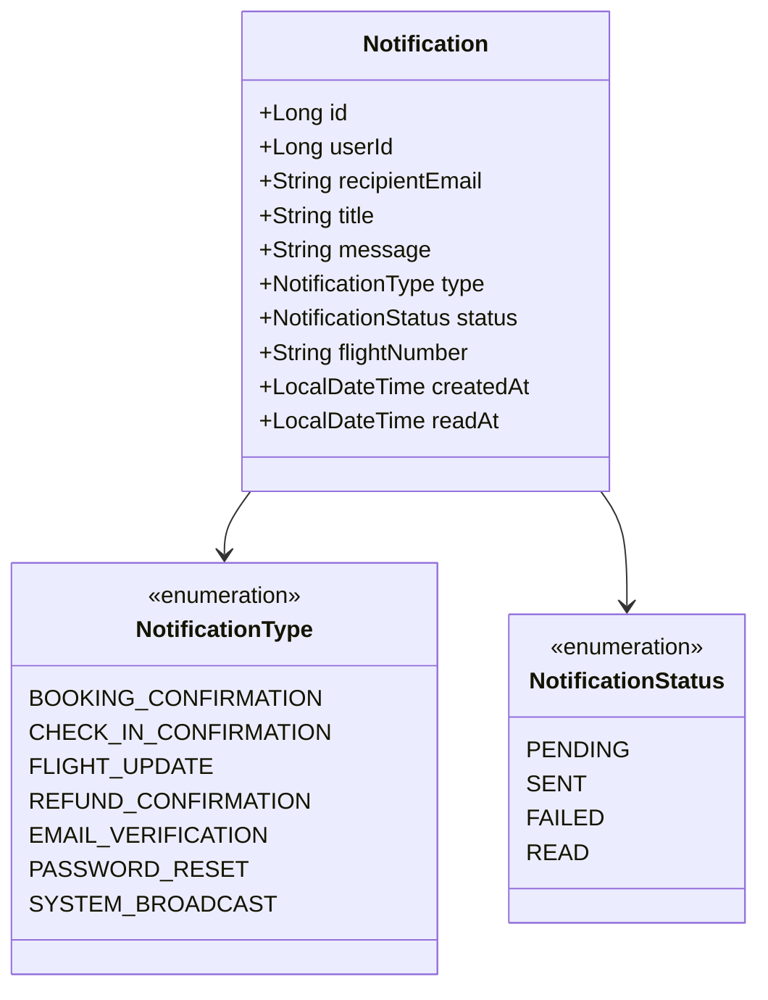

# Notification Service Documentation

## 1. Executive Summary & Responsibility
The **Notification Service** (`notification-service`) manages outbound email communications, on-the-fly PDF document generation (e-tickets and boarding passes), and persistent in-app notifications. It provides transactional notifications for user onboarding, booking confirmations, airport check-in receipts, flight schedule alterations, payment refunds, and administrative platform broadcasts.

- **Service Name**: `notification-service`
- **Default Port**: `8091`
- **Application Context**: `/`
- **Base URI Path**: `/api/notifications`
- **Spring Boot Version**: `3.3.4` (Java 21)
- **Database Schema**: `aerobook_notification_db` (MySQL)
- **Document Engine**: OpenPDF (fork of iText) for vector PDF e-tickets & boarding passes
- **Email Delivery Engine**: Spring `JavaMailSender` (SMTP) with resilient HTML templates and development logging fallback
- **Service Discovery**: Registered in Eureka as `NOTIFICATION-SERVICE`

---

## 2. Architecture & Domain Model

---

## 3. Database Schema & Tables

### 3.1 `aerobook_notification_db.notifications`
Stores persistent in-app notification records and delivery receipts.

| Column | Type | Constraints | Description |
|---|---|---|---|
| `id` | `BIGINT` | PRIMARY KEY, AUTO_INCREMENT | Notification entity ID |
| `user_id` | `BIGINT` | NULL | Recipient user ID (NULL for global broadcasts) |
| `recipient_email` | `VARCHAR(150)` | NULL | Recipient email address |
| `title` | `VARCHAR(255)` | NOT NULL | Brief headline / subject |
| `message` | `TEXT` | NOT NULL | Notification body content |
| `type` | `VARCHAR(50)` | NOT NULL | Category enum (`NotificationType`) |
| `status` | `VARCHAR(30)` | NOT NULL | Delivery state (`NotificationStatus`) |
| `flight_number` | `VARCHAR(50)` | NULL | Associated flight number (if flight-specific) |
| `created_at` | `DATETIME` | NOT NULL | Notification generation timestamp |
| `read_at` | `DATETIME` | NULL | Timestamp when user opened notification |

---

## 4. REST API Endpoint Catalog

| Method | Path | Request Body / Params | Response Body | Description | Access |
|---|---|---|---|---|---|
| `GET` | `/api/notifications/health` | _None_ | `String` | Health check probe | Public |
| `POST` | `/api/notifications/send` | `NotificationRequest` | `NotificationResponse` (HTTP 201) | Save and send an in-app notification | Internal / Services |
| `POST` | `/api/notifications/email/booking` | `BookingNotificationRequest` | `NotificationResponse` | Send booking confirmation email with attached ticket PDF | Internal / Booking |
| `POST` | `/api/notifications/email/checkin` | `CheckInNotificationRequest` | `NotificationResponse` | Send check-in email with boarding pass PDF | Internal / Check-in |
| `POST` | `/api/notifications/email/flight-alert`| `FlightAlertNotificationRequest` | `NotificationResponse` | Alert passengers of flight delays or gate changes | Internal / Staff |
| `POST` | `/api/notifications/email/refund` | `RefundNotificationRequest` | `NotificationResponse` | Send payment refund notification email | Internal / Payment |
| `POST` | `/api/notifications/email/verify` | `EmailVerificationRequest` | `NotificationResponse` | Send registration 6-digit OTP code | Internal / Auth |
| `POST` | `/api/notifications/email/reset-password`| `EmailVerificationRequest` | `NotificationResponse` | Send password reset verification code | Internal / Auth |
| `POST` | `/api/notifications/broadcast` | `BroadcastRequest` | `NotificationResponse` | Broadcast alert to all active users | Admin |
| `GET` | `/api/notifications/user/{userId}` | Path: `userId` | `List<NotificationResponse>` | Get user's in-app notification inbox | Authenticated |
| `PUT` | `/api/notifications/{id}/read` | Path: `id` | `NotificationResponse` | Mark single notification as read | Authenticated |
| `PUT` | `/api/notifications/user/{userId}/read-all`| Path: `userId` | `Void` (HTTP 200) | Mark all user notifications as read | Authenticated |
| `GET` | `/api/notifications/unread-count/{userId}` | Path: `userId` | `Long` | Count unread notifications for badge counter | Authenticated |
| `GET` | `/api/notifications` | _None_ | `List<NotificationResponse>` | List all platform notifications | Admin |
| `GET` | `/api/notifications/pdf/ticket` | Query: `pnr`, `flightNumber`, etc. | `byte[]` (`application/pdf`) | Generate on-the-fly e-ticket PDF download | Authenticated |
| `GET` | `/api/notifications/pdf/boarding-pass` | Query: `boardingPassNumber`, etc. | `byte[]` (`application/pdf`) | Generate on-the-fly boarding pass PDF download | Authenticated |

---

## 5. PDF Generation & Email Dispatch Engine
1. **Dynamic PDF Generation**:
   - Built on `OpenPDF` (com.github.librepdf:openpdf:2.0.3).
   - Generates vector-quality airline e-tickets and boarding passes with barcode placeholders, seat allocations, flight numbers, and passenger details.
   - Streams directly to HTTP client response (`application/pdf`) or attaches to outgoing MIME multipart email.
2. **Resilient Email Dispatching**:
   - Configured via `spring.mail.host`, `spring.mail.port`, `spring.mail.username`, and `spring.mail.password`.
   - When SMTP credentials are unconfigured or in offline development, the service falls back to structured logging without failing the upstream business transaction.

