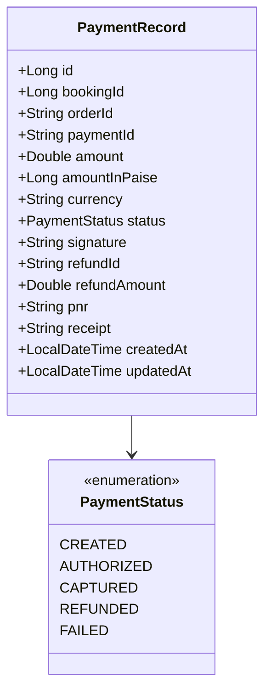

# Payment Service Documentation

## 1. Executive Summary & Responsibility
The **Payment Service** (`payment-service`) integrates AeroBook with Razorpay payment gateways to process secure online ticket purchases, cryptographic signature verifications, and automated refunds. It manages the complete financial transaction lifecycle, translating booking amounts into Indian Paise (`amount * 100`), verifying HMAC-SHA256 signatures, handling asynchronous webhook notifications, and executing partial or full refunds upon booking cancellation.

- **Service Name**: `payment-service`
- **Default Port**: `8092`
- **Application Context**: `/`
- **Base URI Path**: `/api/payments`
- **Spring Boot Version**: `3.3.4` (Java 21)
- **Database Schema**: `aerobook_payment_db` (MySQL)
- **Payment Gateway**: Razorpay API (`razorpay-java:1.4.3`) with HMAC-SHA256 verification
- **Service Discovery**: Registered in Eureka as `PAYMENT-SERVICE`

---

## 2. Architecture & Domain Model



---

## 3. Database Schema & Tables

### 3.1 `aerobook_payment_db.payments`
Stores transaction records, gateway order references, and cryptographic proofs.

| Column | Type | Constraints | Description |
|---|---|---|---|
| `id` | `BIGINT` | PRIMARY KEY, AUTO_INCREMENT | Payment entity ID |
| `booking_id` | `BIGINT` | NOT NULL | Associated reservation ID in `booking-service` |
| `pnr` | `VARCHAR(20)` | NULL | Associated booking PNR |
| `order_id` | `VARCHAR(100)` | NOT NULL, UNIQUE | Razorpay Order ID (e.g. `order_M1bC7x...`) |
| `payment_id` | `VARCHAR(100)` | NULL | Razorpay Payment ID (e.g. `pay_N8eR4z...`) |
| `amount` | `DOUBLE` | NOT NULL | Transaction amount in standard currency (INR) |
| `amount_in_paise`| `BIGINT` | NOT NULL | Amount in subunit Paise (`amount * 100`) |
| `currency` | `VARCHAR(10)` | NOT NULL, DEFAULT `'INR'` | Currency code |
| `receipt` | `VARCHAR(100)` | NULL | Internal receipt / invoice reference |
| `status` | `VARCHAR(20)` | NOT NULL, DEFAULT `'CREATED'` | `CREATED`, `AUTHORIZED`, `CAPTURED`, `REFUNDED`, `FAILED` |
| `signature` | `VARCHAR(255)` | NULL | Cryptographic HMAC-SHA256 payment signature |
| `refund_id` | `VARCHAR(100)` | NULL | Razorpay Refund ID upon cancellation |
| `refund_amount` | `DOUBLE` | NULL | Refunded sum in INR |
| `created_at` | `DATETIME` | NOT NULL | Payment creation timestamp |
| `updated_at` | `DATETIME` | NULL | Last status update timestamp |

---

## 4. REST API Endpoint Catalog

| Method | Path | Request Body / Params | Response Body | Description | Access |
|---|---|---|---|---|---|
| `GET` | `/api/payments/health` | _None_ | `String` | Health check probe | Public |
| `POST` | `/api/payments/orders` | `PaymentOrderRequest` | `PaymentOrderResponse` (HTTP 201) | Create Razorpay order ID for booking | Authenticated |
| `POST` | `/api/payments/verify` | `PaymentVerifyRequest` | `PaymentVerifyResponse` | Verify HMAC signature & capture payment | Authenticated |
| `POST` | `/api/payments/webhook` | Webhook Payload & Header: `X-Razorpay-Signature` | `ResponseEntity` | Asynchronous Razorpay webhook receiver | Gateway / Webhook |
| `POST` | `/api/payments/{id}/refund` | `PaymentRefundRequest` | `PaymentRefundResponse` | Initiate partial or full ticket refund | Authenticated / Staff |
| `GET` | `/api/payments` | _None_ | `List<PaymentRecord>` | List all payment transactions across platform | Admin / Staff |
| `GET` | `/api/payments/{id}` | Path: `id` | `PaymentRecord` | Retrieve payment record by ID | Authenticated / Admin |
| `GET` | `/api/payments/booking/{bookingId}` | Path: `bookingId` | `PaymentRecord` | Retrieve payment record by booking ID | Authenticated / Admin |

---

## 5. Razorpay Checkout & Cryptographic Verification Workflow

```mermaid
sequenceDiagram
    autonumber
    actor Customer as Passenger (Frontend)
    participant Gateway as API Gateway (8083)
    participant Payment as Payment Service (8092)
    participant Razorpay as Razorpay Cloud Gateway
    participant DB as aerobook_payment_db

    Customer->>Gateway: POST /api/payments/orders (bookingId, amount)
    Gateway->>Payment: Route Order Request
    Payment->>Razorpay: orders.create(amount: amount*100, currency: INR)
    Razorpay-->>Payment: order_id (e.g. order_M1bC7x)
    Payment->>DB: INSERT payments (status: CREATED, orderId)
    Payment-->>Gateway-->>Customer: Order Details (orderId, keyId, amount)
    Customer->>Razorpay: Open Razorpay Modal & Complete Payment
    Razorpay-->>Customer: Returns {razorpay_order_id, razorpay_payment_id, razorpay_signature}
    Customer->>Gateway: POST /api/payments/verify
    Gateway->>Payment: Route Verification
    Payment->>Payment: Compute HMAC_SHA256(order_id + "|" + payment_id, secret)
    alt Signature Matches
        Payment->>DB: UPDATE payments SET status = 'CAPTURED', paymentId, signature
        Payment-->>Customer: Verification Success (PaymentStatus: CAPTURED)
    else Signature Mismatch
        Payment->>DB: UPDATE payments SET status = 'FAILED'
        Payment-->>Customer: 400 Bad Request (Invalid Signature)
    end
```

