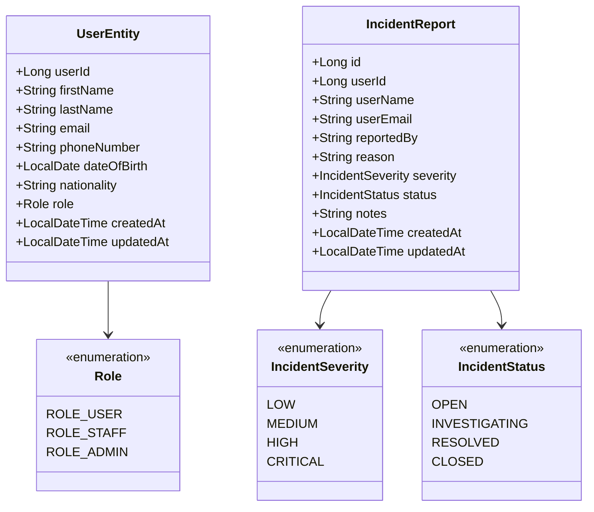

# User Service Documentation

## 1. Executive Summary & Responsibility
The **User Service** (`user-service`) manages passenger profile records, customer demographic attributes, and airport operations staff incident reports. It operates as the central profile store for the AeroBook platform, decoupling customer identity metadata from authentication credentials (`auth-service`). It also provides an incident escalation and tracking system used by airline operations staff to flag passenger conduct, check-in issues, or security discrepancies.

- **Service Name**: `user-service`
- **Default Port**: `8084`
- **Application Context**: `/`
- **Base URI Path**: `/api/v1/users`
- **Spring Boot Version**: `3.3.4` (Java 21)
- **Database Schema**: `aerobook_user_db` (MySQL)
- **Service Discovery**: Registered in Eureka as `USER-SERVICE`

---

## 2. Architecture & Domain Model

---

## 3. Database Schema & Tables

### 3.1 `aerobook_user_db.users`
Stores user profile information.

| Column | Type | Constraints | Description |
|---|---|---|---|
| `user_id` | `BIGINT` | PRIMARY KEY, AUTO_INCREMENT | Unique user profile identifier |
| `first_name` | `VARCHAR(100)` | NOT NULL | Passenger / user first name |
| `last_name` | `VARCHAR(100)` | NOT NULL | Passenger / user surname |
| `email` | `VARCHAR(150)` | NOT NULL, UNIQUE | User contact email |
| `phone_number`| `VARCHAR(20)` | NULL | Mobile contact number |
| `date_of_birth`| `DATE` | NULL | Date of birth for booking & TSA rules |
| `nationality` | `VARCHAR(50)` | NULL | Passenger nationality (e.g., Indian) |
| `role` | `VARCHAR(30)` | NOT NULL, DEFAULT `'ROLE_USER'` | Profile role (`ROLE_USER`, `ROLE_STAFF`, `ROLE_ADMIN`) |
| `created_at` | `DATETIME` | NOT NULL | Account creation timestamp |
| `updated_at` | `DATETIME` | NULL | Last modification timestamp |

### 3.2 `aerobook_user_db.incident_reports`
Stores security and operational incident records submitted by staff or administrators regarding passengers.

| Column | Type | Constraints | Description |
|---|---|---|---|
| `id` | `BIGINT` | PRIMARY KEY, AUTO_INCREMENT | Incident ticket ID |
| `user_id` | `BIGINT` | NOT NULL | Target passenger profile ID |
| `user_name` | `VARCHAR(100)` | NOT NULL | Full name of reported user |
| `user_email`| `VARCHAR(100)` | NOT NULL | Email address of reported user |
| `reported_by`| `VARCHAR(100)` | NOT NULL | Staff or admin username/email |
| `reason` | `VARCHAR(500)` | NOT NULL | Incident summary or violation |
| `severity` | `VARCHAR(20)` | NOT NULL, DEFAULT `'MEDIUM'` | `LOW`, `MEDIUM`, `HIGH`, `CRITICAL` |
| `status` | `VARCHAR(20)` | NOT NULL, DEFAULT `'OPEN'` | `OPEN`, `INVESTIGATING`, `RESOLVED`, `CLOSED` |
| `notes` | `VARCHAR(1000)`| NULL | Internal operational logs and investigation notes |
| `created_at` | `DATETIME` | NOT NULL | Incident filing timestamp |
| `updated_at` | `DATETIME` | NULL | Last status update timestamp |

---

## 4. REST API Endpoint Catalog

### 4.1 User Profiles (`UserController`)

| Method | Path | Request Body | Response Body | Description | Access |
|---|---|---|---|---|---|
| `GET` | `/api/v1/users/health` | _None_ | `String` ("User Service is Running") | Liveness probe | Public |
| `POST` | `/api/v1/users` | `UserRequest` | `UserResponse` (HTTP 201) | Create new user profile | Internal / Auth |
| `GET` | `/api/v1/users` | _None_ | `List<UserResponse>` | Retrieve all user profiles | Admin / Staff |
| `GET` | `/api/v1/users/{id}` | _None_ | `UserResponse` | Get profile by user ID | Authenticated |
| `GET` | `/api/v1/users/email/{email}` | _None_ | `UserResponse` | Get profile by user email | Authenticated |
| `PUT` | `/api/v1/users/{id}` | `UserRequest` | `UserResponse` | Update user profile details | Owner / Admin |
| `DELETE` | `/api/v1/users/{id}` | _None_ | `Void` (HTTP 204) | Delete user profile | Admin |

### 4.2 Incident Reports (`IncidentController`)

| Method | Path | Request Body | Response Body | Description | Access |
|---|---|---|---|---|---|
| `GET` | `/api/v1/users/incidents` | _None_ | `List<IncidentReportResponse>` | List all filed incidents | Admin / Staff |
| `GET` | `/api/v1/users/incidents/{id}` | _None_ | `IncidentReportResponse` | Get incident details by ticket ID | Admin / Staff |
| `POST` | `/api/v1/users/incidents` | `IncidentReportRequest` | `IncidentReportResponse` (HTTP 201) | Report passenger incident | Staff / Admin |
| `PUT` | `/api/v1/users/incidents/{id}/status` | Query: `status` | `IncidentReportResponse` | Update incident workflow status | Staff / Admin |
| `DELETE`| `/api/v1/users/incidents/{id}` | _None_ | `Void` (HTTP 204) | Delete incident ticket | Admin |
| `GET` | `/api/v1/users/incidents/count/open` | _None_ | `Long` | Count open incidents for staff dashboard | Staff / Admin |

---

## 5. Key Dependencies & Configuration
- **Spring Cloud Config Client**: Fetches properties from `config-server:8080`.
- **Spring Cloud Eureka Client**: Registers with `service-discovery:8761`.
- **Spring Data JPA & Hibernate**: ORM mapping for MySQL `aerobook_user_db`.
- **ModelMapper / DTO Mapper**: Maps `UserEntity` and `IncidentReport` to clean response objects.
- **Actuator**: Health and metrics exposed under `/actuator`.

