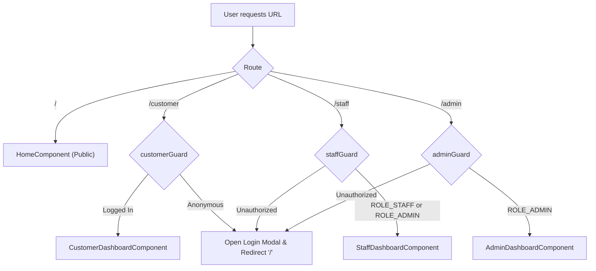

# Frontend Application Documentation

## 1. Executive Summary & Architecture Overview
The **AeroBook Frontend** (`frontend`) is a modern, responsive Single Page Application (SPA) built with **Angular 18**. It utilizes Angular's latest architectural patterns: **Standalone Components**, **Angular Signals** for reactive fine-grained state management, and a custom atomic design component system (`ab-*`). The frontend communicates exclusively with the backend through the Spring Cloud API Gateway (`http://localhost:8083`), enforcing a strict Single Entry Point architecture.

- **Framework**: Angular `18.2.0`
- **Language**: TypeScript `5.5.4`
- **State Management**: Angular Signals (`signal()`, `computed()`)
- **Component Architecture**: 100% Standalone Components (zero NgModules)
- **Styling Architecture**: Custom CSS Design Tokens with dual-theme engine (`light` / `dark`)
- **API Target**: `http://localhost:8083` (API Gateway)
- **Default Port**: `4200` (`ng serve`)

---

## 2. Directory Layout & Module Structure

```text
frontend/src/app/
├── app.component.ts               # Root component container
├── app.config.ts                  # Application providers (HttpClient, Router, Interceptors)
├── app.routes.ts                  # Top-level client route definitions & guards
├── core/
│   ├── api/                       # Typed REST API service clients
│   ├── guards/                    # Functional route guards (customerGuard, staffGuard, adminGuard)
│   ├── interceptors/              # HTTP Auth token injection & error handlers
│   ├── models/                    # TypeScript interfaces & domain models
│   ├── services/                  # Core singleton services (AuthService, BookingService, etc.)
│   └── theme/                     # ThemeService & design token managers
├── features/
│   ├── home/                      # Public landing page, flight search, booking teaser
│   ├── customer/                  # Passenger dashboard (my bookings, check-in, profile)
│   ├── staff/                     # Airport staff dashboard (gate verify, passenger lookup, incidents)
│   └── admin/                     # Admin operations (fleet, flights, fares, coupons, analytics)
└── shared/
    ├── components/                # Composite UI modules (navbar, login-modal, register-modal)
    └── ui/                        # Atomic "ab-*" UI Component Library (20+ components)
```

---

## 3. UI Component Library (`ab-*`)
The application features a built-in atomic component library prefixed with `ab-`, designed for aviation UI workflows and consistent accessibility:

| Component | Selector | Purpose |
|---|---|---|
| `ab-button` | `<ab-button>` | Primary, secondary, outline, ghost, and danger button variants |
| `ab-card` | `<ab-card>` | Structured content container with header, body, footer slots |
| `ab-hero-card` | `<ab-hero-card>` | Hero highlight section with flight imagery and CTA |
| `ab-stat-card` | `<ab-stat-card>` | Metric card for dashboard stats (revenue, active flights) |
| `ab-ticket` | `<ab-ticket>` | Realistic perforated boarding pass / e-ticket card display |
| `ab-table` | `<ab-table>` | Data table with sorting, pagination, and action slots |
| `ab-modal` | `<ab-modal>` | Accessible dialog modal backdrop with keyboard traps |
| `ab-input` | `<ab-input>` | Validated input field with floating labels and icons |
| `ab-select` | `<ab-select>` | Custom styled dropdown select |
| `ab-checkbox` | `<ab-checkbox>` | Accessible checkbox input |
| `ab-toggle` | `<ab-toggle>` | Switch toggle (e.g., active coupon status) |
| `ab-segmented` | `<ab-segmented>` | Segmented button group (e.g. cabin class tabs) |
| `ab-status-pill` | `<ab-status-pill>`| Colored badge (`CONFIRMED`, `ON_TIME`, `DELAYED`, `OPEN`) |
| `ab-meter` | `<ab-meter>` | Capacity progress bar for aircraft seats |
| `ab-spark` | `<ab-spark>` | Micro sparkline for trend visualization |
| `ab-skeleton` | `<ab-skeleton>` | Shimmer placeholder during asynchronous data loading |
| `ab-empty-state` | `<ab-empty-state>`| Placeholder when query returns zero records |
| `ab-error-state` | `<ab-error-state>`| User-friendly error message container with retry action |

---

## 4. State Management with Angular Signals
The frontend replaces RxJS Subject-heavy stores with lightweight, reactive Angular Signals:
- **`AuthService` Signals**:
  - `tokenSignal = signal<string | null>(...)`
  - `roleSignal = signal<RoleType | null>(...)`
  - `isAuthenticated = computed(() => !!this.tokenSignal())`
  - `isAdmin = computed(() => ...)`
  - `isStaff = computed(() => ...)`
  - `isCustomer = computed(() => !this.isAdmin() && !this.isStaff())`
  - `loginModalOpen = signal<boolean>(false)`
  - `registerModalOpen = signal<boolean>(false)`
- **`ThemeService` Signals**:
  - `theme = signal<'light' | 'dark'>(...)`
  - `isDark = computed(() => this.theme() === 'dark')`
  - Automatically updates root `<html>` attribute `data-theme` and synchronizes with `localStorage`.

---

## 5. Client-Side Routing & Route Protection
Protected routes are secured using functional Angular CanActivateFn guards:



---

## 6. HTTP Interceptors & Token Propagation
1. **JWT Auth Interceptor**:
   - Intercepts all outgoing requests directed at `http://localhost:8083`.
   - Inspects `AuthService.currentToken()`.
   - Appends `Authorization: Bearer <jwt-token>` header automatically.
2. **Error Interceptor**:
   - Catches HTTP `401 Unauthorized` responses: Clears authentication state, prompts the login modal, and redirects to home.
   - Catches HTTP `403 Forbidden` responses: Displays unauthorized warning notifications.
   - Catches HTTP `500` / connection failures: Renders `ab-error-state` with retry logic.

