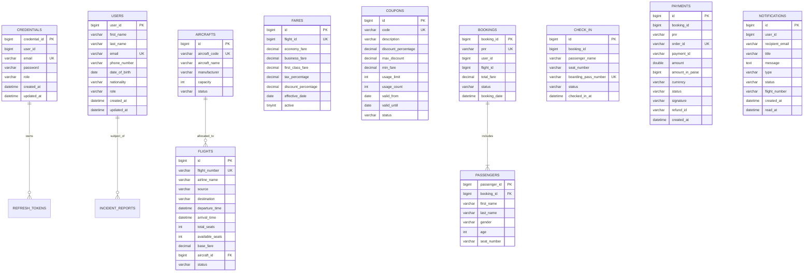

# Database Design & Persistence Architecture

## 1. Architectural Philosophy: Database-Per-Service
AeroBook strictly adheres to the **Database-per-Service** architectural pattern. Each business domain microservice owns its private, isolated MySQL database schema. No microservice is permitted to execute direct SQL queries, joins, or mutations against a database owned by another microservice. 

All cross-domain queries and data synchronizations are orchestrated via:
1. **Synchronous OpenFeign REST calls** for operational dependencies (e.g., Booking Service querying Flight Service for seat availability).
2. **Asynchronous RabbitMQ AMQP messaging** for state propagation (e.g., Booking Created events reducing flight seat inventory).
3. **Identity Token Claims** for user context propagation (`X-User-Id`, `X-User-Role`).

```mermaid
graph TD
    subgraph Auth Domain
        AS[auth-service:8082] --> DB1[(aerobook_auth_db)]
    end
    subgraph User Domain
        US[user-service:8084] --> DB2[(aerobook_user_db)]
    end
    subgraph Flight Domain
        FS[flight-service:8087] --> DB3[(aerobook_flight_db)]
    end
    subgraph Fare Domain
        FRS[fare-service:8089] --> DB4[(aerobook_fare_db)]
    end
    subgraph Booking Domain
        BS[booking-service:8088] --> DB5[(aerobook_booking_db)]
    end
    subgraph Check-In Domain
        CS[check-in-service:8090] --> DB6[(aerobook_checkin_db)]
    end
    subgraph Notification Domain
        NS[notification-service:8091] --> DB7[(aerobook_notification_db)]
    end
    subgraph Payment Domain
        PS[payment-service:8092] --> DB8[(aerobook_payment_db)]
    end
```

---

## 2. Complete Entity-Relationship Diagrams (ERD)

---

## 3. Database Schemas & Table DDL Reference

### 3.1 `aerobook_auth_db`
- **`credentials`**: User authentication records. Primary key `credential_id`, unique index on `email`, hashed passwords using BCrypt ($2a$10$).
- **`refresh_tokens`**: Rotating refresh tokens for session renewal. Foreign reference to `credential_id`.
- **`email_verifications`**: OTP storage with 15-minute TTL expirations.

### 3.2 `aerobook_user_db`
- **`users`**: Master customer demographics. Primary key `user_id`, unique index on `email`.
- **`incident_reports`**: Passenger conduct and airport security reports. Columns: `id`, `user_id`, `user_name`, `user_email`, `reported_by`, `reason`, `severity`, `status`, `notes`.

### 3.3 `aerobook_flight_db`
- **`aircrafts`**: Commercial aircraft fleet inventory. Primary key `id`, unique index on `aircraft_code`.
- **`flights`**: Commercial flight schedules. Primary key `id`, unique index on `flight_number`, foreign key referencing `aircrafts.id`. Real-time `available_seats` tracking.

### 3.4 `aerobook_fare_db`
- **`fares`**: Cabin-class pricing tiers. Primary key `id`, unique foreign reference `flight_id`.
- **`coupons`**: Promotional discount codes. Primary key `id`, unique index on `code`. Fields include `usage_limit`, `usage_count`, and date bounds.

### 3.5 `aerobook_booking_db`
- **`bookings`**: Master reservation records. Primary key `booking_id`, unique index on `pnr`.
- **`passengers`**: Individual traveler details. Primary key `passenger_id`, foreign key referencing `bookings.booking_id`.

### 3.6 `aerobook_checkin_db`
- **`check_in`**: Boarding pass issuance records. Primary key `id`, unique index on `boarding_pass_number`, status transition from `CHECKED_IN` to `BOARDED`.

### 3.7 `aerobook_payment_db`
- **`payments`**: Financial transactions. Primary key `id`, unique index on `order_id`, tracking Razorpay `payment_id`, `signature`, and refund lifecycle.

### 3.8 `aerobook_notification_db`
- **`notifications`**: User alert inbox. Primary key `id`, index on `user_id`, storing title, message, status (`PENDING`, `SENT`, `READ`), and timestamps.

---

## 4. Master Data Seeding Strategy (`scripts/seed.sql`)
The platform includes an automated master database seeding script at `scripts/seed.sql` (39.6 KB, 429 lines).
- Creates all 8 databases with `utf8mb4` encoding and collation `utf8mb4_unicode_ci`.
- Creates missing table schemas.
- Seeds 20 preconfigured user accounts (Admins, Airport Staff, and Passengers) with hashed BCrypt passwords.
- Seeds 15 commercial aircraft (Boeing 737, Airbus A320, Boeing 787).
- Seeds 30 scheduled commercial flights across major Indian airport hubs (DEL, BOM, BLR, CCU, HYD, MAA, GOI).
- Seeds tiered fares and active promotional coupons (`FLY500`, `AERO10`, `WELCOME20`).
- Seeds historical sample bookings, passenger manifests, check-ins, payments, notifications, and incident reports.

