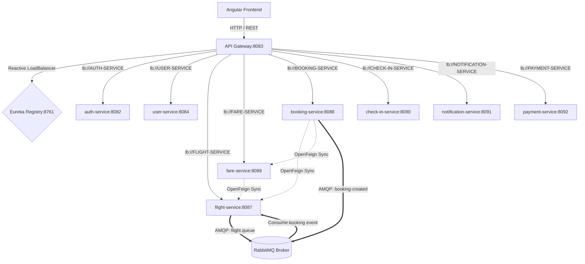
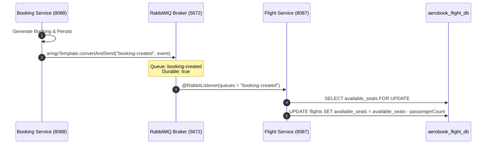

# Inter-Service Communication Architecture

## 1. Communication Paradigm Overview
AeroBook combines **synchronous HTTP REST (via Spring Cloud OpenFeign)** for query-response dependencies requiring immediate operational consistency, and **asynchronous AMQP (via RabbitMQ)** for state change propagation, eventual consistency, and cross-service event fanout.



---

## 2. Master Inter-Service Communication Matrix

| Source Service | Target Service | Protocol / Transport | Pattern | Destination / Channel | Purpose |
|---|---|---|---|---|---|
| `api-gateway` | All Microservices | HTTP / REST | Request / Response | `lb://<SERVICE-NAME>` | Edge routing, JWT validation, header enrichment |
| `booking-service` | `flight-service` | HTTP / OpenFeign | Synchronous RPC | `GET /api/flights/{id}` | Validate flight status & available seat inventory |
| `booking-service` | `fare-service` | HTTP / OpenFeign | Synchronous RPC | `GET /api/fares/flight/{id}` | Retrieve cabin pricing for ticket cost calculation |
| `fare-service` | `flight-service` | HTTP / OpenFeign | Synchronous RPC | `GET /api/flights/{id}` | Verify flight existence before assigning fare pricing |
| `booking-service` | `flight-service` | AMQP / RabbitMQ | Asynchronous Event | Queue: `booking-created` | Atomically decrement available seats upon ticket confirmation |
| `flight-service` | Downstream Services| AMQP / RabbitMQ | Asynchronous Event | Queue: `flight.queue` | Broadcast schedule changes & seat release events |
| `auth-service` | `notification-service`| HTTP / REST | Synchronous RPC | `POST /api/notifications/email/*` | Dispatch registration OTPs and password reset emails |
| `booking-service` | `notification-service`| HTTP / REST | Synchronous RPC | `POST /api/notifications/email/booking` | Dispatch booking confirmation email with ticket PDF |
| `check-in-service`| `notification-service`| HTTP / REST | Synchronous RPC | `POST /api/notifications/email/checkin` | Dispatch boarding pass confirmation with PDF |

---

## 3. Synchronous OpenFeign Implementation

### 3.1 FlightServiceClient (in `booking-service` & `fare-service`)
```java
@FeignClient(name = "FLIGHT-SERVICE")
public interface FlightServiceClient {
    @GetMapping("/api/flights/{id}")
    FlightResponse getFlightById(@PathVariable("id") Long id);
}
```
- **Service Discovery Integration**: OpenFeign automatically queries Eureka for healthy instance coordinates under service ID `FLIGHT-SERVICE`.
- **Client-Side Load Balancing**: Spring Cloud LoadBalancer distributes concurrent requests across active instances using round-robin.

### 3.2 FareServiceClient (in `booking-service`)
```java
@FeignClient(name = "FARE-SERVICE")
public interface FareServiceClient {
    @GetMapping("/api/fares/flight/{flightId}")
    FareResponse getFareByFlightId(@PathVariable("flightId") Long flightId);
}
```

---

## 4. Asynchronous AMQP RabbitMQ Infrastructure

### 4.1 Topology Configuration
- **Broker Port**: `5672` (AMQP), `15672` (Management Dashboard)
- **Message Converter**: Jackson 2 JSON Message Converter (`Jackson2JsonMessageConverter`) ensures language-agnostic JSON payload serialization.



### 4.2 Resiliency & Fault Isolation
- **Durable Queues**: Queues are configured as `durable = true` to prevent message loss during broker restarts.
- **Decoupled Failures**: If `flight-service` undergoes temporary downtime or redeployment, booking transactions complete without failure; seat adjustment events remain queued until `flight-service` reconnects.

