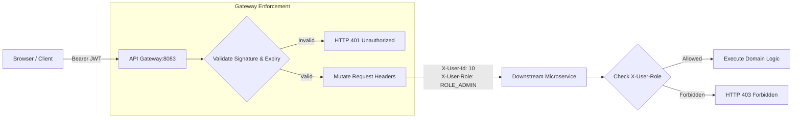

# Platform Security & Authentication Architecture

## 1. Security Philosophy & Edge Enforcement
AeroBook implements a **defense-in-depth, perimeter-enforced security architecture**. The platform uses stateless **JSON Web Tokens (JWT)** for identity verification and access delegation.

Authentication is centralized at the **API Gateway** (`api-gateway:8083`):
1. **Edge JWT Verification**: Inbound requests with `Authorization: Bearer <token>` are cryptographically validated by the Gateway's reactive `JwtAuthenticationFilter`.
2. **Context Enrichment & Mutation**: Valid tokens have their claims extracted (`userId`, `email`, `role`). The Gateway mutates the downstream HTTP request, appending standard HTTP headers:
   - `X-User-Id`: Numeric ID of the authenticated user.
   - `X-User-Email`: Email address of the authenticated user.
   - `X-User-Role`: Assigned role (`ROLE_USER`, `ROLE_STAFF`, `ROLE_ADMIN`).
3. **Downstream Service Defense**: Microservices trust the gateway-propagated `X-User-*` headers, eliminating repeated asymmetric cryptography calculations while enforcing RBAC at the service layer.



---

## 2. JWT Token Specification & Cryptography
- **Library**: JJWT `0.12.7` (`jjwt-api`, `jjwt-impl`, `jjwt-jackson`).
- **Signature Algorithm**: HMAC-SHA256 (`HS256`).
- **Secret Key**: Defined via `jwt.secret` (minimum 256 bits, Base64/Hex encoded).
- **Token Lifespans**:
  - **Access Token TTL**: 24 hours (86,400,000 ms).
  - **Refresh Token TTL**: 7 days (604,800,000 ms).
- **Token Claims Payload**:
  ```json
  {
    "sub": "admin@aerobook.com",
    "userId": 10,
    "role": "ROLE_ADMIN",
    "iat": 1729238400,
    "exp": 1729324800
  }
  ```

---

## 3. Role-Based Access Control (RBAC) Matrix

The platform classifies operations into three distinct personas:
- **`ROLE_USER` (Passenger)**: Can search flights, view schedules, book tickets, check in, download boarding passes, manage own profile, and cancel own bookings.
- **`ROLE_STAFF` (Airport Operations Staff)**: Can view passenger manifests, scan and verify boarding passes at departure gates (`/api/check-ins/verify`), search flights, view bookings, and file passenger incident reports.
- **`ROLE_ADMIN` (System Administrator)**: Full platform governance, including aircraft fleet registration, flight scheduling, cabin fare configuration, promo coupon creation, user role modifications, incident resolutions, and transaction auditing.

| Feature / Domain | Endpoint Group | ROLE_USER | ROLE_STAFF | ROLE_ADMIN |
|---|---|:---:|:---:|:---:|
| **Flight Search** | `/api/flights/**` (GET) | Allowed | Allowed | Allowed |
| **Fleet Management** | `/api/admin/aircrafts/**` | Denied | View Only | Full CRUD |
| **Flight Management** | `/api/admin/flights/**` | Denied | View Only | Full CRUD |
| **Fare Configuration**| `/api/fares/**` | View Only | View Only | Full CRUD |
| **Coupon Management** | `/api/fares/coupons/**` | Validate Only | Validate Only | Full CRUD |
| **Booking Creation** | `POST /api/bookings` | Allowed | Allowed | Allowed |
| **Booking Oversight** | `GET /api/bookings` | Denied | Allowed | Allowed |
| **Self Check-In** | `POST /api/check-ins` | Allowed | Allowed | Allowed |
| **Gate Verification** | `POST /api/check-ins/verify` | Denied | Allowed | Allowed |
| **Manifest Audit** | `GET /api/check-ins` | Denied | Allowed | Allowed |
| **Incident Reports** | `/api/v1/users/incidents/**` | Denied | File & View | Full CRUD |
| **User Administration**| `/api/v1/users/**` | Self Profile | View Manifest | Full CRUD |
| **Role Modification** | `PUT /api/auth/credentials/{id}/role` | Denied | Denied | Allowed |
| **Payment Orders** | `POST /api/payments/orders` | Allowed | Allowed | Allowed |
| **Payment Refunds** | `POST /api/payments/{id}/refund` | Denied | Allowed | Allowed |

---

## 4. Administrative Bootstrapping & Setup Keys
To prevent unauthorized privilege escalation while allowing secure containerized bootstrapping, privileged registration endpoints enforce **Setup Keys**:
- `POST /api/auth/register-admin`: Requires header/body parameter matching `aerobook.setup-key.admin` (e.g. `ADMIN_SECRET_KEY_2026`).
- `POST /api/auth/register-staff`: Requires header/body parameter matching `aerobook.setup-key.staff` (e.g. `STAFF_SECRET_KEY_2026`).

---

## 5. Password Security & BCrypt Hashing
Passwords are never stored in plaintext. They are salted and hashed using `BCryptPasswordEncoder` with a cost factor (strength) of `10`:
- Standard BCrypt signature format: `$2a$10$...`
- Prevents rainbow table attacks, dictionary attacks, and timing leaks.

