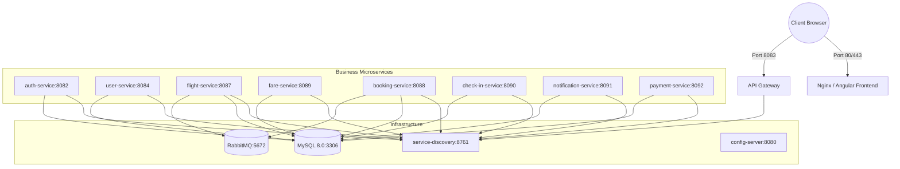

# Deployment & Containerization Architecture

## 1. Containerization Strategy
AeroBook is architected for containerized deployment across local development, staging, and cloud container orchestration platforms (Docker Swarm, Kubernetes, Amazon ECS).

Each component follows modern container packaging standards:
- **Java 21 Spring Boot Microservices**: Packaged using multi-stage Docker builds based on `eclipse-temurin:21-jre-alpine` for minimal attack surface and sub-200MB image footprints.
- **Angular 18 Frontend**: Built using Node.js `20-alpine` and served via high-performance `nginx:alpine` with HTML5 pushState routing rules and gzip/brotli compression.

---

## 2. Standard Multi-Stage Dockerfile Patterns

### 2.1 Backend Spring Boot Services
```dockerfile
# Stage 1: Build & Package
FROM maven:3.9.8-eclipse-temurin-21-alpine AS builder
WORKDIR /workspace
COPY pom.xml .
COPY src ./src
RUN mvn clean package -DskipTests

# Stage 2: Minimal Distroless / JRE Runtime
FROM eclipse-temurin:21-jre-alpine
WORKDIR /app
RUN addgroup -S appgroup && adduser -S appuser -G appgroup
USER appuser
COPY --from=builder /workspace/target/*.jar app.jar
EXPOSE 8080
ENTRYPOINT ["java", "-XX:+UseG1GC", "-XX:MaxRAMPercentage=75.0", "-jar", "app.jar"]
```

### 2.2 Angular 18 Frontend
```dockerfile
# Stage 1: Build Single Page Application
FROM node:20-alpine AS builder
WORKDIR /app
COPY package*.json ./
RUN npm ci
COPY . .
RUN npm run build -- --configuration production

# Stage 2: Serve via Nginx
FROM nginx:1.27-alpine
COPY nginx.conf /etc/nginx/conf.d/default.conf
COPY --from=builder /app/dist/frontend/browser /usr/share/nginx/html
EXPOSE 80
CMD ["nginx", "-g", "daemon off;"]
```

---

## 3. Production Docker Compose Architecture



---

## 4. Kubernetes Deployment Architecture (Production Target)
For enterprise production scale, AeroBook maps directly into standard Kubernetes constructs:

```text
k8s/
├── namespaces/
│   └── aerobook.yaml               # Dedicated isolated namespace
├── configmaps/
│   └── platform-config.yaml        # Common environment parameters
├── secrets/
│   └── platform-secrets.yaml       # Base64 encoded DB passwords & JWT secrets
├── deployments/
│   ├── eureka-deployment.yaml      # 2 replicas with pod anti-affinity
│   ├── gateway-deployment.yaml     # 3 replicas with HorizontalPodAutoscaler
│   └── microservices-*.yaml        # Individual stateless microservice deployments
└── ingress/
    └── aerobook-ingress.yaml       # Nginx Ingress Controller with Let's Encrypt TLS
```

### Readiness & Liveness Probes
Every Spring Boot deployment leverages Spring Actuator endpoints:
```yaml
livenessProbe:
  httpGet:
    path: /actuator/health/liveness
    port: 8080
  initialDelaySeconds: 45
  periodSeconds: 10
readinessProbe:
  httpGet:
    path: /actuator/health/readiness
    port: 8080
  initialDelaySeconds: 30
  periodSeconds: 5
```

---

## 5. Graceful Shutdown & Zero Downtime
All Spring Boot services have graceful shutdown enabled:
```properties
server.shutdown=graceful
spring.lifecycle.timeout-per-shutdown-phase=30s
```
When SIGTERM is received during rolling updates, embedded Tomcat/Netty halts new inbound connections while permitting in-flight HTTP requests and AMQP messages up to 30 seconds to complete.

