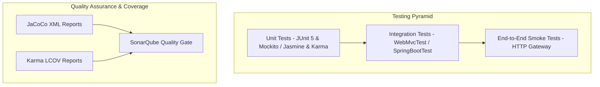

# Testing & Quality Assurance Architecture

## 1. Testing Strategy Overview
AeroBook adopts a comprehensive testing pyramid encompassing unit testing, mock-isolated service layer testing, slice controller testing (`@WebMvcTest`), end-to-end smoke tests, and automated static code analysis via **SonarQube**.



---

## 2. Backend Unit & Integration Testing
- **Framework**: JUnit 5 (Jupiter) & Mockito.
- **Assertion Engine**: AssertJ (`org.assertj.core.api.Assertions`).
- **Spring Testing Support**: `spring-boot-starter-test`.

### 2.1 Service Layer Testing Pattern
Service tests utilize Mockito to mock repository layers and external Feign clients, verifying business validation, domain rules, and exception throwing in total isolation from the database:
```java
@ExtendWith(MockitoExtension.class)
class BookingServiceImplTest {
    @Mock private BookingRepository bookingRepository;
    @Mock private FlightServiceClient flightClient;
    @Mock private FareServiceClient fareClient;
    @Mock private RabbitTemplate rabbitTemplate;
    @InjectMocks private BookingServiceImpl bookingService;

    @Test
    void createBooking_Successful_ReturnsConfirmedResponse() {
        // Mock seat availability & fare calculations
        // Assert PNR generation and status == CONFIRMED
    }
}
```

### 2.2 Controller Slice Testing Pattern
Controllers are tested using `@WebMvcTest` with Spring Security mock contexts to verify HTTP status codes, request body validations (`@Valid`), and serialization behaviors:
```java
@WebMvcTest(FlightSearchController.class)
class FlightSearchControllerTest {
    @Autowired private MockMvc mockMvc;
    @MockBean private FlightSearchService flightSearchService;

    @Test
    void searchFlights_ValidQuery_ReturnsOk() throws Exception {
        mockMvc.perform(get("/api/flights/search")
                .param("source", "DEL")
                .param("destination", "BOM"))
                .andExpect(status().isOk());
    }
}
```

---

## 3. Frontend Component & Service Testing
- **Test Runner**: Karma (`karma.conf.js`).
- **Framework**: Jasmine 5.x.
- **Coverage Tool**: `karma-coverage` generating HTML and LCOV reports at `frontend/coverage/lcov.info`.

### Test Execution Commands
```bash
cd frontend
# Run tests headlessly for CI/CD
npm test -- --watch=false --browsers=ChromeHeadless --code-coverage
```

---

## 4. Code Coverage Reporting (JaCoCo)
All 11 backend microservices are configured with the **JaCoCo Maven Plugin** (`jacoco-maven-plugin:0.8.12`):
- Automatically binds to the Maven `test` and `prepare-agent` lifecycles.
- Generates standard XML coverage reports at `target/site/jacoco/jacoco.xml`.
- Standard exclusions: Generated configuration classes, Lombok/DTO boilerplate, and entity POJOs.

### Running Backend Coverage
```bash
mvn clean test jacoco:report
```

---

## 5. SonarQube Code Quality & Security Analysis
SonarQube is integrated across all microservices and the Angular frontend.

### 5.1 SonarQube Metrics & Quality Gates
- **Bugs & Vulnerabilities**: 0 Blocker, 0 Critical.
- **Security Hotspots**: 100% reviewed.
- **Code Smells & Technical Debt**: Debt ratio under 5%.
- **Duplicated Lines**: Less than 3.0% duplication.
- **Test Coverage**: Tracked via ingested JaCoCo XML and LCOV reports.

### 5.2 Executing SonarQube Scans
```bash
# Analyze all Java services
mvn sonar:sonar -Dsonar.host.url=http://localhost:9000 -Dsonar.token=[TOKEN]

# Analyze Angular Frontend
cd frontend
npx sonar-scanner \
  -Dsonar.projectKey=aerobook-frontend \
  -Dsonar.sources=src \
  -Dsonar.tests=src \
  -Dsonar.test.inclusions=**/*.spec.ts \
  -Dsonar.javascript.lcov.reportPaths=coverage/lcov.info \
  -Dsonar.host.url=http://localhost:9000 \
  -Dsonar.token=[TOKEN]
```

