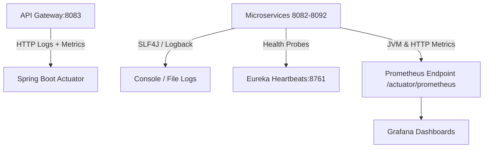

# Observability, Monitoring & Logging Architecture

## 1. Observability Strategy Overview
AeroBook adopts a distributed observability architecture structured around three key pillars: **Centralized Logging**, **Health & Readiness Probes**, and **Application Performance Metrics**.



---

## 2. Distributed Logging Architecture

### 2.1 SLF4J & Logback Configuration
All microservices implement SLF4J backed by Logback, utilizing a standardized ANSI colorized logging pattern:
```properties
logging.level.root=INFO
logging.level.com.aerobook=DEBUG
logging.level.org.springframework.cloud.gateway=INFO
logging.pattern.console=%clr(%d{yyyy-MM-dd HH:mm:ss.SSS}){faint} %clr(%5p) %clr(${PID:- }){magenta} --- [%15.15t] %clr(%-40.40logger{39}){cyan} : %m%n
```

### 2.2 Distributed Correlation IDs
To trace user transactions across the microservices ecosystem, the API Gateway intercepts incoming requests and attaches an `X-Correlation-Id` header (using a unique UUID) if not already provided.
- Downstream services log the correlation ID in their Mapped Diagnostic Context (MDC).
- Allows engineers to trace an entire distributed flow (e.g. `Client -> Gateway -> Booking Service -> Flight Service -> RabbitMQ`) using a single correlation search key.

---

## 3. Health Checks & Spring Boot Actuator
Every microservice exposes operational health and telemetry under the `/actuator` management context.

### 3.1 Actuator Endpoints Directory

| Endpoint | Path | Purpose |
|---|---|---|
| **Health Probe** | `/actuator/health` | Comprehensive health check evaluating database connectivity, disk space, and AMQP broker connections. |
| **Liveness Probe** | `/actuator/health/liveness` | Kubernetes liveness probe indicating if the JVM process is alive and responsive. |
| **Readiness Probe**| `/actuator/health/readiness` | Kubernetes readiness probe indicating if the service has completed initialization and can accept traffic. |
| **Service Metrics**| `/actuator/metrics` | Real-time JVM memory heap usage, garbage collection latency, thread pools, and HTTP request metrics. |
| **Application Info**| `/actuator/info` | Application name, build version, and Spring Boot version metadata. |

### 3.2 Actuator Configuration
```properties
management.endpoints.web.exposure.include=health,info,metrics,prometheus
management.endpoint.health.show-details=always
management.endpoint.health.probes.enabled=true
```

---

## 4. Eureka Service Discovery Telemetry
- **Heartbeat Interval**: Client microservices send heartbeats every 30 seconds (`eureka.instance.lease-renewal-interval-in-seconds=30`).
- **Lease Expiration**: Registry marks unrenewed instances as down after 90 seconds.
- **Self-Preservation Mode**: If network partitions cause more than 15% of heartbeats to drop suddenly, Eureka activates self-preservation mode to prevent mass deregistration of healthy instances.
- **Admin Dashboard**: Accessible at `http://localhost:8761` displaying active instances, IP addresses, up/down statuses, and JVM memory.

