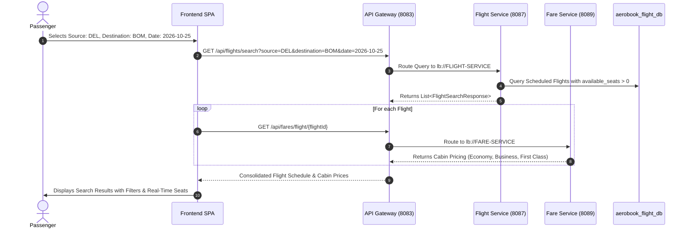

# Core Business Workflows & Sequence Flows

This document details the primary end-to-end business processes in the AeroBook aviation platform, accompanied by comprehensive Mermaid sequence diagrams.

---

## Workflow 1: User Registration, OTP Verification & Authentication

```mermaid
sequenceDiagram
    autonumber
    actor User as Passenger / Staff
    participant Angular as Frontend SPA (4200)
    participant Gateway as API Gateway (8083)
    participant Auth as Auth Service (8082)
    participant Notif as Notification Service (8091)
    participant Mail as SMTP Mail Server
    participant UserSvc as User Service (8084)
    participant DB as aerobook_auth_db

    User->>Angular: Enters Registration Form (Email, Name, Password)
    Angular->>Gateway: POST /api/auth/send-verification-code ({email})
    Gateway->>Auth: Forward Request
    Auth->>Auth: Generate 6-digit OTP & Store in email_verifications
    Auth->>Notif: POST /api/notifications/email/verify
    Notif->>Mail: Send Registration OTP Email
    Auth-->>Gateway-->>Angular: 200 OK (OTP Sent)
    
    User->>Angular: Enters 6-digit OTP Code
    Angular->>Gateway: POST /api/auth/verify-code ({email, code})
    Gateway->>Auth: Validate OTP in email_verifications
    Auth-->>Gateway-->>Angular: 200 OK (Code Verified)
    
    User->>Angular: Confirms Registration
    Angular->>Gateway: POST /api/auth/register ({email, password, role, ...})
    Gateway->>Auth: Save Encrypted Password (BCrypt) to credentials
    Auth->>UserSvc: POST /api/v1/users (create user profile)
    Auth-->>Gateway-->>Angular: 201 Created
    
    User->>Angular: Submits Login Form ({email, password})
    Angular->>Gateway: POST /api/auth/login
    Gateway->>Auth: Verify BCrypt Hash
    Auth->>Auth: Generate HMAC-SHA256 JWT Token + Refresh Token
    Auth-->>Gateway-->>Angular: Returns JWT Token, Role, User Profile
    Angular->>Angular: Store Token in Signals & LocalStorage
```

---

## Workflow 2: Flight Search & Real-Time Availability Lookup



---

## Workflow 3: Booking Reservation & Seat Allocation

```mermaid
sequenceDiagram
    autonumber
    actor Passenger as Passenger
    participant Angular as Frontend SPA
    participant Gateway as API Gateway (8083)
    participant Booking as Booking Service (8088)
    participant Flight as Flight Service (8087)
    participant Fare as Fare Service (8089)
    participant Broker as RabbitMQ Broker
    participant BookingDB as aerobook_booking_db

    Passenger->>Angular: Selects Flight, Cabin Class, and Enters Passenger Names
    Angular->>Gateway: POST /api/bookings (flightId, passengers) with Bearer JWT
    Gateway->>Gateway: Verify JWT, Inject X-User-Id, X-User-Role
    Gateway->>Booking: Route to lb://BOOKING-SERVICE
    
    Booking->>Flight: OpenFeign: GET /api/flights/{flightId}
    Note over Booking,Flight: Verify flight is active and availableSeats >= passengers.size()
    
    Booking->>Fare: OpenFeign: GET /api/fares/flight/{flightId}
    Booking->>Booking: Calculate Total Fare (Base Fare + Taxes - Discounts)
    Booking->>Booking: PnrGenerator.generatePnr() (e.g., AERO9X)
    
    Booking->>BookingDB: Save Booking (CONFIRMED) & Passenger Records
    Booking->>Broker: Publish BookingCreatedEvent to "booking-created" queue
    Booking-->>Gateway-->>Angular: 201 Created (BookingResponse with PNR)
    
    Broker->>Flight: Async AMQP Consumer: Decrement availableSeats
    Flight->>Flight: UPDATE flights SET available_seats = available_seats - N
```

---

## Workflow 4: Razorpay Payment Processing & Verification

```mermaid
sequenceDiagram
    autonumber
    actor Passenger as Passenger
    participant Angular as Frontend SPA
    participant Gateway as API Gateway (8083)
    participant Payment as Payment Service (8092)
    participant Razorpay as Razorpay API
    participant Notif as Notification Service (8091)
    participant DB as aerobook_payment_db

    Passenger->>Angular: Clicks "Proceed to Pay"
    Angular->>Gateway: POST /api/payments/orders ({bookingId, amount})
    Gateway->>Payment: Route Order Request
    Payment->>Payment: Convert to Paise: amount * 100
    Payment->>Razorpay: orders.create({amount: paise, currency: "INR"})
    Razorpay-->>Payment: Returns Razorpay Order ID (e.g. order_M1bC7x...)
    Payment->>DB: Save PaymentRecord (status: CREATED)
    Payment-->>Gateway-->>Angular: Returns {orderId, amount, keyId}
    
    Angular->>Razorpay: Open Razorpay Checkout Modal
    Passenger->>Razorpay: Completes Payment (UPI / Card / NetBanking)
    Razorpay-->>Angular: Returns {orderId, paymentId, signature}
    
    Angular->>Gateway: POST /api/payments/verify ({orderId, paymentId, signature})
    Gateway->>Payment: Route Verification
    Payment->>Payment: Compute HMAC-SHA256(orderId + "|" + paymentId, secret)
    Note over Payment: Verify calculated hash equals razorpay_signature
    Payment->>DB: UPDATE payments SET status = 'CAPTURED', payment_id, signature
    Payment->>Notif: POST /api/notifications/email/booking (trigger e-ticket PDF email)
    Payment-->>Gateway-->>Angular: 200 OK (Payment Verified & Captured)
```

---

## Workflow 5: Passenger Check-In & Boarding Pass Issuance

```mermaid
sequenceDiagram
    autonumber
    actor Passenger as Passenger
    participant Angular as Frontend SPA
    participant Gateway as API Gateway (8083)
    participant CheckIn as Check-In Service (8090)
    participant Notif as Notification Service (8091)
    participant DB as aerobook_checkin_db

    Passenger->>Angular: Navigates to Check-In, inputs PNR & chooses Seat "14B"
    Angular->>Gateway: POST /api/check-ins ({bookingId, passengerName, seatNumber: "14B"})
    Gateway->>CheckIn: Forward Request
    CheckIn->>CheckIn: Format Boarding Pass Number: BP-{bookingId}-14B
    CheckIn->>DB: INSERT INTO check_in (status: 'CHECKED_IN', ...)
    CheckIn->>Notif: POST /api/notifications/email/checkin
    Notif->>Notif: OpenPDF: Generate Vector Boarding Pass PDF
    Notif-->>Passenger: Send Email with Boarding Pass PDF Attachment
    CheckIn-->>Gateway-->>Angular: 200 OK (CheckIn Record with Boarding Pass Number)
    Angular->>Passenger: Displays Boarding Pass Card & Download PDF button
```

---

## Workflow 6: Airport Departure Gate Verification

```mermaid
sequenceDiagram
    autonumber
    actor Staff as Airport Operations Staff
    participant StaffUI as Staff Portal (Angular / Mobile Scanner)
    participant Gateway as API Gateway (8083)
    participant CheckIn as Check-In Service (8090)
    participant DB as aerobook_checkin_db

    Staff->>StaffUI: Scans Boarding Pass Barcode: "BP-102-14B"
    StaffUI->>Gateway: POST /api/check-ins/verify?boardingPassNumber=BP-102-14B
    Gateway->>Gateway: Verify JWT has ROLE_STAFF or ROLE_ADMIN
    Gateway->>CheckIn: Route with X-User-Role: ROLE_STAFF
    CheckIn->>DB: SELECT * FROM check_in WHERE boarding_pass_number = 'BP-102-14B'
    CheckIn->>DB: UPDATE check_in SET status = 'BOARDED'
    CheckIn-->>Gateway-->>StaffUI: 200 OK (Passenger Boarded Successfully)
    StaffUI->>Staff: Visual Green Audio/Visual Clearance: "PASSENGER BOARDED"
```

---

## Workflow 7: Booking Cancellation & Automated Refund

```mermaid
sequenceDiagram
    autonumber
    actor Passenger as Passenger
    participant Angular as Frontend SPA
    participant Gateway as API Gateway (8083)
    participant Booking as Booking Service (8088)
    participant Payment as Payment Service (8092)
    participant Flight as Flight Service (8087)
    participant Razorpay as Razorpay API
    participant Notif as Notification Service (8091)

    Passenger->>Angular: Clicks "Cancel Booking" for PNR
    Angular->>Gateway: DELETE /api/bookings/{bookingId}
    Gateway->>Booking: Route Cancellation
    Booking->>Booking: UPDATE bookings SET status = 'CANCELLED'
    
    Booking->>Flight: Restitution: Release reserved passenger seats
    Flight->>Flight: Increment available_seats
    
    Booking->>Payment: POST /api/payments/{id}/refund
    Payment->>Razorpay: payments.refund(paymentId, amount)
    Razorpay-->>Payment: Returns Refund ID (e.g. rfnd_P9qR2...)
    Payment->>Payment: UPDATE payments SET status = 'REFUNDED', refund_id
    Payment->>Notif: POST /api/notifications/email/refund
    Notif-->>Passenger: Email Refund Credit Receipt
    Booking-->>Gateway-->>Angular: 204 No Content (Booking Cancelled & Refunded)
```

