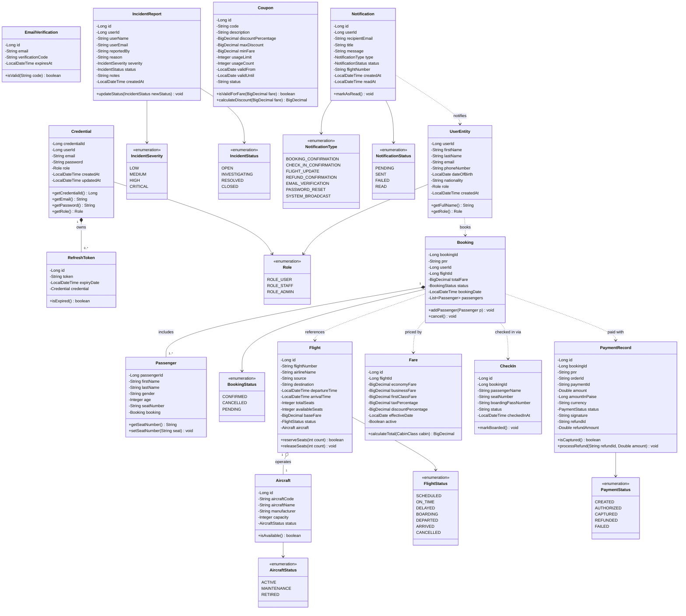

# AeroBook Platform - Class Diagram

## 1. Overview & Presentation Notes
The **Class Diagram** models the domain object structures, attributes, operational methods, and structural relationships across the AeroBook microservices ecosystem. It illustrates how business entities encapsulate data and behaviors across decoupled domain boundaries while maintaining semantic links (such as PNRs, booking IDs, and flight numbers).

### Presentation Talking Points
- **Domain-Driven Design (DDD)**: Each bounded context encapsulates its own entity models (e.g. `Flight`, `Fare`, `Booking`, `PaymentRecord`).
- **Data Integrity & Immutability**: Critical identifiers such as `pnr` (Passenger Name Record), `boardingPassNumber`, and `orderId` provide immutable audit keys.
- **Enumerations for Lifecycle Control**: State machines are governed strictly via typed enumerations (`FlightStatus`, `BookingStatus`, `PaymentStatus`, `IncidentStatus`).

---

## 2. Comprehensive Class Diagram

---

## 3. Structural Summary & Domain Boundaries

| Service Domain | Primary Entities | Key Methods & Responsibilities |
|---|---|---|
| **Identity & Auth** | `Credential`, `RefreshToken`, `EmailVerification` | Secure authentication, BCrypt hashing, JWT issuance, token rotation |
| **User & Staff** | `UserEntity`, `IncidentReport` | Customer demographics, staff incident reporting and escalation |
| **Fleet & Flights** | `Flight`, `Aircraft` | Route scheduling, seat inventory allocation, status monitoring |
| **Fares & Pricing** | `Fare`, `Coupon` | Dynamic cabin tier pricing, tax calculation, coupon validation |
| **Reservations** | `Booking`, `Passenger` | PNR generation, passenger manifest management, cancellation |
| **Check-In & Gate** | `CheckIn` | Digital seat allocation, boarding pass issuance (`BP-*`), gate verification |
| **Payments** | `PaymentRecord` | Razorpay order creation, cryptographic HMAC verification, refunds |
| **Notifications** | `Notification` | Transactional email dispatch, vector PDF e-tickets/boarding passes |

