# AeroBook Platform - Entity-Relationship (ER) Diagram

## 1. Overview & Presentation Notes
The **Entity-Relationship (ER) Diagram** depicts the relational schemas, primary keys (`PK`), foreign keys (`FK`), unique keys (`UK`), and data types across the **8 isolated MySQL microservice databases** underpinning the AeroBook platform.

### Presentation Talking Points
- **Database-per-Service Architecture**: No service queries another service's tables directly; schemas are strictly decoupled to eliminate database-level deadlocks and enable autonomous scaling.
- **Master Data Seeding & Relational Integrity**: All tables use UTF-8 (`utf8mb4`) encoding with relational cascading within domains (e.g. `bookings` cascading to `passengers`).
- **Logical Cross-Domain References**: Inter-service relationships are maintained using logical foreign keys (`flight_id`, `booking_id`, `user_id`, `pnr`).

---

## 2. Complete Entity-Relationship Diagram

```mermaid
erDiagram
    %% AUTH DB
    CREDENTIALS ||--o{ REFRESH_TOKENS : "has many"
    CREDENTIALS ||--o{ EMAIL_VERIFICATIONS : "validates via"
    CREDENTIALS {
        bigint credential_id PK
        bigint user_id
        varchar email UK
        varchar password
        varchar role
        datetime created_at
        datetime updated_at
    }
    REFRESH_TOKENS {
        bigint id PK
        varchar token UK
        bigint credential_id FK
        datetime expiry_date
    }
    EMAIL_VERIFICATIONS {
        bigint id PK
        varchar email
        varchar verification_code
        datetime expires_at
    }

    %% USER DB
    USERS ||--o{ INCIDENT_REPORTS : "reported for"
    USERS {
        bigint user_id PK
        varchar first_name
        varchar last_name
        varchar email UK
        varchar phone_number
        date date_of_birth
        varchar nationality
        varchar role
        datetime created_at
        datetime updated_at
    }
    INCIDENT_REPORTS {
        bigint id PK
        bigint user_id FK
        varchar user_name
        varchar user_email
        varchar reported_by
        varchar reason
        varchar severity
        varchar status
        varchar notes
        datetime created_at
        datetime updated_at
    }

    %% FLIGHT DB
    AIRCRAFTS ||--o{ FLIGHTS : "allocated to"
    AIRCRAFTS {
        bigint id PK
        varchar aircraft_code UK
        varchar aircraft_name
        varchar manufacturer
        int capacity
        varchar status
        datetime created_at
        datetime updated_at
    }
    FLIGHTS {
        bigint id PK
        varchar flight_number UK
        varchar airline_name
        varchar source
        varchar destination
        datetime departure_time
        datetime arrival_time
        int total_seats
        int available_seats
        decimal base_fare
        bigint aircraft_id FK
        varchar status
    }

    %% FARE DB
    FARES {
        bigint id PK
        bigint flight_id UK
        decimal economy_fare
        decimal business_fare
        decimal first_class_fare
        decimal tax_percentage
        decimal discount_percentage
        date effective_date
        tinyint active
    }
    COUPONS {
        bigint id PK
        varchar code UK
        varchar description
        decimal discount_percentage
        decimal max_discount
        decimal min_fare
        int usage_limit
        int usage_count
        date valid_from
        date valid_until
        varchar status
        datetime created_at
        datetime updated_at
    }

    %% BOOKING DB
    BOOKINGS ||--|{ PASSENGERS : "contains"
    BOOKINGS {
        bigint booking_id PK
        varchar pnr UK
        bigint user_id
        bigint flight_id
        decimal total_fare
        varchar status
        datetime booking_date
    }
    PASSENGERS {
        bigint passenger_id PK
        bigint booking_id FK
        varchar first_name
        varchar last_name
        varchar gender
        int age
        varchar seat_number
    }

    %% CHECK-IN DB
    CHECK_IN {
        bigint id PK
        bigint booking_id
        varchar passenger_name
        varchar seat_number
        varchar boarding_pass_number UK
        varchar status
        datetime checked_in_at
    }

    %% PAYMENT DB
    PAYMENTS {
        bigint id PK
        bigint booking_id
        varchar pnr
        varchar order_id UK
        varchar payment_id
        double amount
        bigint amount_in_paise
        varchar currency
        varchar receipt
        varchar status
        varchar signature
        varchar refund_id
        double refund_amount
        datetime created_at
        datetime updated_at
    }

    %% NOTIFICATION DB
    NOTIFICATIONS {
        bigint id PK
        bigint user_id
        varchar recipient_email
        varchar title
        text message
        varchar type
        varchar status
        varchar flight_number
        datetime created_at
        datetime read_at
    }
```

---

## 3. Relational Schema Summary & Database Mapping

| Database Schema | Primary Table | Subsidiary Tables | Logical Cross-Database Linkages |
|---|---|---|---|
| `aerobook_auth_db` | `credentials` | `refresh_tokens`, `email_verifications` | Maps to `users.user_id` and `users.email` |
| `aerobook_user_db` | `users` | `incident_reports` | Referenced by `bookings.user_id` and `notifications.user_id` |
| `aerobook_flight_db` | `flights` | `aircrafts` | Referenced by `bookings.flight_id` and `fares.flight_id` |
| `aerobook_fare_db` | `fares` | `coupons` | Logical 1:1 with `flights.id` via `fares.flight_id` |
| `aerobook_booking_db` | `bookings` | `passengers` | Linked to `payments.booking_id` and `check_in.booking_id` |
| `aerobook_checkin_db` | `check_in` | _None_ | References `bookings.booking_id` |
| `aerobook_payment_db` | `payments` | _None_ | References `bookings.booking_id` and `bookings.pnr` |
| `aerobook_notification_db` | `notifications` | _None_ | Indexed by `user_id` and `recipient_email` |

