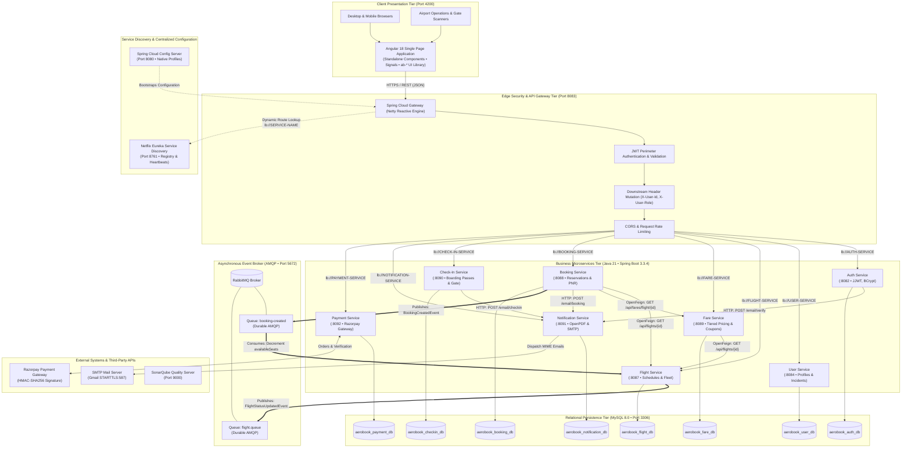

# AeroBook Platform - System Architecture Diagram

## 1. Overview & Presentation Notes
The **System Architecture Diagram** illustrates the end-to-end, multi-tier enterprise microservices topology of the AeroBook platform. It illustrates how client requests traverse the edge security perimeter, resolve downstream microservices dynamically via Netflix Eureka, execute synchronous and asynchronous inter-service workflows, and persist state in isolated databases.

### Presentation Talking Points
- **Single Point of Ingress**: The Angular 18 Single Page Application interacts exclusively with the Spring Cloud API Gateway (Port 8083), decoupling client applications from internal microservice network topology.
- **Perimeter Security Model**: Cryptographic JWT validation occurs at the Gateway. Validated claims are propagated downstream as trusted HTTP headers (`X-User-Id`, `X-User-Role`), optimizing internal request performance.
- **Hybrid Communication Architecture**: Combines synchronous OpenFeign RPC for instant consistency with asynchronous RabbitMQ AMQP messaging for resilient, decoupled background workflows.
- **Database-Per-Service Autonomy**: 8 dedicated MySQL schemas prevent coupling and eliminate cross-domain database contention.

---

## 2. Complete System Architecture Diagram

---

## 3. Tiered Architectural Responsibilities

| Tier | Component | Technological Role |
|---|---|---|
| **Presentation** | Angular 18 SPA | Client user experience, Signals reactive state, atomic design token theming (`light`/`dark`) |
| **Edge Ingress** | Spring Cloud Gateway | Non-blocking reactive routing, Netty engine, JWT validation, header enrichment, CORS |
| **Discovery** | Netflix Eureka | Dynamic instance registration, client-side load balancing, automatic health heartbeat leasing |
| **Configuration** | Spring Cloud Config | Centralized configuration management with native profile resolution |
| **Core Business** | 8 Spring Boot Services | Domain business logic, transaction isolation, REST controllers, OpenFeign RPC clients |
| **Messaging** | RabbitMQ Broker | Asynchronous AMQP event decoupling, durable queues, fault-tolerant seat synchronization |
| **Persistence** | 8 MySQL Schemas | Isolated database-per-service relational persistence, transactional data integrity |
| **Third-Party** | Razorpay & Gmail | Payment processing, cryptographic signature validation, automated email notifications |

